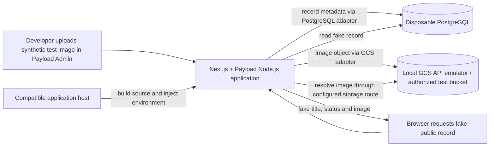

<user_constraints>
## User Constraints (from CONTEXT.md)

### Locked Decisions

#### Exabytes assessment and safety
- **D-01:** Begin with read-only review of the existing Exabytes account. Do not change the account, its live WordPress site, production hosting, DNS, or other production settings without the owner's explicit approval.
- **D-02:** If Exabytes evidence is missing, do not infer or guess. Record exactly what is missing and ask the owner for the required information or redacted evidence. Keep Exabytes-specific conclusions and decisions pending until adequate evidence is available; local host-independent work may continue.
- **D-03:** Any Exabytes write/change test requires explicit approval for that specific test before it is performed. Purchasing, upgrading, subscribing to, or creating chargeable Exabytes resources requires explicit approval.
- **D-04:** Never request or place passwords, tokens, or other secrets in planning records. Account evidence can be capability descriptions or screenshots with sensitive details removed.

#### Representative application test and retained foundation
- **D-05:** Build a minimal end-to-end representative slice covering the approved architecture conceptually: Next.js, Payload CMS, PostgreSQL, external object/media storage, and public application output. The exact implementation is for research and planning to determine.
- **D-06:** Use only clearly fake, disposable test data and images. Do not use real customer data, machinery documentation, JPJ originals, private production documents, or sensitive business data.
- **D-07:** Retain the application structure, framework/CMS foundation, database and storage integration/configuration, environment structure, appropriate development tooling, and deployment approach as the starter foundation for later phases. Remove or keep separate only disposable feasibility records, images, and test data; do not build a throwaway application.

#### Portability and external services
- **D-08:** Portability means the same GitHub source can be rebuilt and redeployed on a compatible application host using documented environment configuration, without rewriting or materially redesigning the application. A destination rebuild is expected; a single identical prebuilt artifact across hosts is not required. Keep application-host-specific settings isolated and PostgreSQL and object storage separable from the app host where practical. Avoid Exabytes-specific coupling.
- **D-09:** Perform a real second-host deployment only if a compatible test host/resource is already available. If none is available, document the repeatable process, assumptions, and requirements, and leave deployment verification pending. Ask for explicit approval before creating an account, subscription, paid resource, or potentially chargeable infrastructure. Any portability test uses only fake, disposable data.
- **D-10:** Preserve PostgreSQL; never substitute the existing Exabytes MariaDB. A managed PostgreSQL provider need not be permanently selected before local development unless technically necessary. Google Cloud Storage is the planned object-storage direction, but do not create paid/cloud resources without approval; appropriate local/test substitutes are acceptable if compatible with the approved production architecture.

#### Handoff and scope
- **D-11:** Make setup and deployment requirements understandable and maintainable by later Codex/GSD sessions or another developer. Technical deployment and maintenance remain developer/agent tasks. Routine HGR inventory/content management in later phases must be through Payload, without requiring the owner to use VS Code, GitHub, a terminal, or code editing.
- **D-12:** Keep Phase 1 within foundation, representative architecture test, Exabytes feasibility, portability, and documentation. Detailed inventory/admin workflows, photography and JPJ handling, public pages, leads, secondary enquiries, design, SEO, analytics, security/recovery, training and launch belong to their assigned later phases. Do not add CRM, ecommerce, customer accounts, bookings, automatic Mudah sync, blog, or mass SEO-page generation.
- **D-13:** Exabytes unsuitability is a reported compatibility finding, not a reason to redesign the application around Exabytes limitations. Preserve the portable architecture while the owner considers a suitable host.

### the agent's Discretion
- Choose the simplest maintainable local/test implementation that proves the stated architecture path while preserving compatibility with the approved stack and avoiding unapproved paid resources.
- Determine the exact fake record, test image, technical checks, and repeatable deployment instructions during research and planning; keep them clearly separated from real HGR data and production services.
- Treat absent account/host evidence as an explicit pending verification rather than a pass or a guessed result.

### Deferred Ideas (OUT OF SCOPE)
Detailed HGR inventory and owner workflows, structured photography and responsive processing, protected JPJ originals and approved redactions, public inventory and machine pages, contact/enquiry flows, secondary business pages, visual design, SEO, analytics, privacy/security, backup/recovery, owner training, and launch readiness remain in their assigned roadmap phases. No new deferred ideas were raised.
</user_constraints>

<phase_requirements>
## Phase Requirements

| ID | Description | Research Support |
|----|-------------|------------------|
| PORT-01 | Developers can build a Next.js and Payload application using PostgreSQL without using the existing Exabytes MariaDB. | Payload documents an official PostgreSQL adapter; use an isolated PostgreSQL service and verify Payload startup and a persisted fake record. Do not configure MariaDB. |
| PORT-02 | Deployers can set database, media, mail, domain and other environment-specific values without editing source code or committing secrets. | Keep runtime settings in host-provided environment variables; keep `.env.example` names only, exclude `.env`; avoid `NEXT_PUBLIC_` for secrets because Next.js bundles those values during build. |
| PORT-03 | Developers can keep uploaded media in external object storage, with Google Cloud Storage as the planned first adapter, independently of the application host. | Payload officially documents its GCS adapter and a local filesystem option. Plan a local GCS endpoint emulator integration check or use a compatible test endpoint; a local-disk-only upload does not prove this requirement. |
| PORT-04 | Developers can rebuild and redeploy the same application source on a compatible application host without rewriting or materially redesigning it. | Use documented build/start commands and environment-only host configuration; test a destination rebuild only if a compatible test resource already exists and is authorized. Otherwise document and mark verification pending. |
| PORT-05 | Developers can run a representative Next.js/Payload startup, PostgreSQL connection, external-media operation and upload-processing smoke test against the actual existing Exabytes account before depending on it for production. | Define a fake-data smoke sequence and the account capabilities to collect. Actual Exabytes writes/uploads remain blocked pending explicit approval for that specific test; do not label local checks as account verification. |
| PORT-06 | Maintainers can document the actual Exabytes test results and required host capabilities without substituting MariaDB or committing to a paid host change. | Record only evidence-backed capability results and exact limits; identify missing evidence as pending. Any unsuitable-host conclusion is a compatibility finding, not an architecture change. |
| PORT-07 | Source code and deployment instructions are kept in the GitHub-backed project with secrets excluded and an environment-variable-name example available. | Retain foundation/configuration and portable deployment notes in the project; check ignore rules, provide names-only `.env.example`, and scan for accidental secrets before completion. |
</phase_requirements>

# Phase 1: Portable foundation and Exabytes feasibility — Research

**Researched:** 2026-09-30  
**Domain:** Next.js + Payload CMS + PostgreSQL + Google Cloud Storage; self-hosted Node.js feasibility and portability  
**Confidence:** MEDIUM for official integration guidance; LOW for installed package versions, Exabytes capabilities, and emulator compatibility

## Summary

The smallest durable foundation is one TypeScript Next.js application with Payload mounted into its App Router, Payload's PostgreSQL adapter, and Payload's official GCS storage adapter. Keep the app, PostgreSQL, and media endpoint separately configured through environment variables. For local work, use a disposable PostgreSQL service and a local GCS API emulator if the adapter works against it; Payload's documented local-filesystem mode is a fallback for CMS/media-flow development, but alone does not prove external object storage. Payload's official deployment guidance supports local uploads for local development and cloud storage for hosts with ephemeral filesystems. [CITED: https://payloadcms.com/docs/getting-started/installation] [CITED: https://payloadcms.com/docs/database/postgres] [CITED: https://payloadcms.com/docs/upload/storage-adapters] [CITED: https://payloadcms.com/docs/production/deployment]

The minimal proving slice should create one obviously fake Payload record, upload one synthetic image, persist record metadata in PostgreSQL and bytes through the external storage adapter, then render a public route that shows the fake record and image. A successful local slice demonstrates the architecture path, not Exabytes compatibility. Exabytes evidence is absent from the reviewed planning state; the actual-account workload test requires a specific write-test approval and redacted evidence, so the account result must stay pending until those gates are met. [VERIFIED: .planning/STATE.md:61-62] Quote: “The actual Exabytes account's application/runtime and upload capability has not been tested. Phase 1 must test it before host-dependent deployment planning.” / “No PostgreSQL/storage/email service or production access has been confirmed or provisioned by these planning files.”

**Primary recommendation:** Build and retain the local TypeScript Next.js/Payload/PostgreSQL foundation, exercise storage against a no-cost local GCS emulator only after confirming its adapter compatibility, document a normal rebuild/redeploy process, and treat every unobserved host capability as pending.

## Architectural Responsibility Map

| Capability | Primary Tier | Secondary Tier | Rationale |
|------------|-------------|----------------|-----------|
| Public output and Payload Admin/API runtime | Frontend Server (SSR) | Browser / Client | Next.js and Payload run together as the application; browser routes reach server-rendered/public output and Payload admin. [CITED: https://payloadcms.com/docs/production/deployment] |
| Structured fake record persistence | Database / Storage | API / Backend | Payload's Postgres adapter owns writes/reads against the separately configured PostgreSQL service. [CITED: https://payloadcms.com/docs/database/postgres] |
| Image bytes and derivatives | Database / Storage | API / Backend | Payload's GCS adapter stores uploads externally; the Payload server accepts/processes the upload and resolves the public route. [CITED: https://payloadcms.com/docs/upload/storage-adapters] |
| Host-specific credentials and runtime values | Frontend Server (SSR) | — | Each compatible host supplies runtime environment values; secrets stay out of source and public browser bundles. [CITED: https://nextjs.org/docs/app/guides/self-hosting] |
| Rebuild and start | Frontend Server (SSR) | CDN / Static | A Node.js server or container runs the built app; a CDN/reverse proxy may serve static assets and shield the app server. [CITED: https://nextjs.org/docs/app/getting-started/deploying] [CITED: https://nextjs.org/docs/app/guides/self-hosting] |

## Standard Stack

### Core

| Library / service | Version | Purpose | Why Standard |
|-------------------|---------|---------|--------------|
| Next.js | Current official Payload install docs list `15.2.9–15.2.x`, `15.3.9–15.3.x`, `15.4.11–15.4.x`, or `16.2.6+`; choose an exact mutually compatible release when installing. | Node.js app, public route, Payload Admin/API integration | Payload's official integration targets Next.js directly; Next.js officially supports Node.js server and Docker deployments with full feature support. [CITED: https://payloadcms.com/docs/getting-started/installation] [CITED: https://nextjs.org/docs/app/getting-started/deploying] |
| Node.js | `20.9.0+` per current Payload installation requirements; confirm selected host version before planning deployment. | Next.js/Payload runtime and build | Explicit minimum in Payload installation docs. [CITED: https://payloadcms.com/docs/getting-started/installation] |
| Payload CMS + `@payloadcms/next` | Exact release not confirmed; align package versions and lock them together at install time. | CMS, Admin, local API, uploads | Required by Payload's official Next.js installation guide. [CITED: https://payloadcms.com/docs/getting-started/installation] |
| `@payloadcms/db-postgres` | Exact release not confirmed; align with Payload release. | PostgreSQL database adapter | Official Payload Postgres adapter uses Drizzle and node-postgres. [CITED: https://payloadcms.com/docs/database/postgres] |
| PostgreSQL | Exact release not selected; choose an available currently maintained version once local service/runtime is confirmed. | Relational database | Approved architecture and official Payload-supported adapter. Never use Exabytes MariaDB. [CITED: https://payloadcms.com/docs/database/overview] |
| `@payloadcms/storage-gcs` | Exact release not confirmed; align with Payload release. | GCS uploads behind a storage adapter | Official Payload GCS adapter exposes bucket, project and configurable API endpoint. [CITED: https://payloadcms.com/docs/upload/storage-adapters] |

### Supporting

| Library / service | Version | Purpose | When to Use |
|-------------------|---------|---------|-------------|
| `sharp` | Exact release not confirmed; align with Payload and Next.js runtime binaries. | Image resizing/cropping for upload processing | Only if this foundation smoke requires Payload image transformations; Payload lists it as optional for upload collections needing image manipulation. [CITED: https://payloadcms.com/docs/getting-started/installation] |
| Docker Compose | Machine currently lacks `docker`; version unavailable. | Disposable local PostgreSQL and emulator services | Use if the maintainer installs/has Docker available; Compose supports independently defined services and environment configuration. Keep passwords in secrets, not ordinary compose values. [CITED: https://docs.docker.com/compose/reference/compose_file/] [CITED: https://docs.docker.com/compose/how-tos/environment-variables/set-environment-variables/] |
| `fsouza/fake-gcs-server` | Image version not checked; exact compatibility unproven. | Local GCS API test endpoint | Use only as a local, fake-data integration candidate. Payload exposes `GCS_ENDPOINT`, but official docs do not certify this emulator; verify create/upload/read/delete through the real adapter. [CITED: https://payloadcms.com/docs/upload/storage-adapters] [CITED: https://github.com/fsouza/fake-gcs-server] |
| `.env.example` | Project convention | Names-only documentation of required environment values | Check in names and safe descriptions only; inject actual values locally/at the host. Never check in `.env`. [CITED: https://docs.docker.com/compose/how-tos/environment-variables/set-environment-variables/] |

### Alternatives Considered

| Instead of | Could Use | Tradeoff |
|------------|-----------|----------|
| Local GCS emulator for local end-to-end storage test | Payload's documented local filesystem upload mode | Simpler and useful for local admin/media-flow work, but it does not prove an external object-storage operation. Keep PORT-03's external operation test separate. [CITED: https://payloadcms.com/docs/production/deployment] |
| GCS as the planned storage service | Any official Payload cloud adapter / compatible object store | Only select another adapter if the owner approves; GCS remains the approved planned first adapter. Changing the adapter can require configuration/migration, so avoid alternative exploration in implementation. [CITED: https://payloadcms.com/docs/production/deployment] |
| Full Next.js Node deployment | Static export | Static export has limited feature support and cannot represent Payload's dynamic admin/API/upload architecture; do not use it for this application. [CITED: https://nextjs.org/docs/app/getting-started/deploying] |

**Installation:** No command was run because this research-only task does not authorize implementation. Official Payload docs show packages `payload`, `@payloadcms/next`, `@payloadcms/db-postgres`, and optionally `@payloadcms/storage-gcs` and `sharp`. Exact current registry versions could not be retrieved from this environment; resolve compatibility and exact versions before locking dependencies. [CITED: https://payloadcms.com/docs/getting-started/installation] [CITED: https://payloadcms.com/docs/upload/storage-adapters]

**Version verification:** `npm view` for the recommended packages produced no result in this session, so no npm version is claimed verified. The Payload docs' supported Next.js ranges and minimum Node version above are current documentation constraints, not a substitute for checking registry versions at implementation time. [CITED: https://payloadcms.com/docs/getting-started/installation]

## Package Legitimacy Audit

> Required because the phase foundation will install external packages. Official docs establish the intended package names, but the required legitimacy seam had unavailable registry metadata in this environment; every result therefore remains flagged for human verification before installation.

| Package | Registry | Age | Downloads | Source Repo | Verdict | Disposition |
|---------|----------|-----|-----------|-------------|---------|-------------|
| `next` | npm | unknown | unknown | official Next.js docs | SUS | Flagged — add `checkpoint:human-verify` before install. |
| `payload` | npm | unknown | unknown | official Payload docs | SUS | Flagged — add `checkpoint:human-verify` before install. |
| `@payloadcms/next` | npm | unknown | unknown | official Payload docs | SUS | Flagged — add `checkpoint:human-verify` before install. |
| `@payloadcms/db-postgres` | npm | unknown | unknown | official Payload docs | SUS | Flagged — add `checkpoint:human-verify` before install. |
| `@payloadcms/storage-gcs` | npm | unknown | unknown | official Payload docs | SUS | Flagged — add `checkpoint:human-verify` before install. |
| `sharp` | npm | unknown | unknown | official Payload docs | SUS | Flagged — add `checkpoint:human-verify` before install if image transforms are included. |

**Packages removed due to SLOP verdict:** none.  
**Packages flagged as suspicious SUS:** all listed packages; the seam returned unknown age/download/repository fields, not affirmative registry data. Keep installs behind human verification and retry the prescribed registry check before implementation. `npm view` also yielded no version output. No package postinstall data was returned, so postinstall scripts remain unreviewed.

## Architecture Patterns

### System Architecture Diagram



The Exabytes node is intentionally marked as an evidence-gated possible destination, not a confirmed host. The local substitute must be fake and isolated; a local success does not answer Exabytes capacity or access questions. [VERIFIED: .planning/STATE.md:61-62] Quote: “The actual Exabytes account's application/runtime and upload capability has not been tested.”

### Recommended Project Structure

```text
app/                 # Next.js routes, including Payload route group
  (payload)/         # Payload Admin and API files supplied by Payload integration
  (site)/            # Minimal public fake-record output route
collections/         # One minimal fake content record and upload collection
payload.config.ts    # Payload, PostgreSQL and GCS configuration
next.config.mjs      # Next.js wrapped with Payload's withPayload integration
compose.yaml         # Local disposable PostgreSQL and GCS-emulator services, if available
.env.example         # Variable names and non-secret descriptions only
docs/deployment/     # Local startup, smoke test, host capability checklist and redeploy steps
```

Keep Payload's generated route files intact and put the public fake route in its own route group. The exact file list should follow the current Payload blank template because the integration guide says its route files import from `@payloadcms/next` and are not meant to be edited. [CITED: https://payloadcms.com/docs/getting-started/installation]

### Pattern 1: Minimal End-to-End Fake-Data Slice

**What:** One Payload text record plus one generated synthetic image; store the record in PostgreSQL, upload bytes through GCS storage, and display both at one public route. [ASSUMED: exact test collection/record shape is an implementation choice; no existing app scaffold.]  
**When to use:** Foundation architecture smoke test only; keep all data separate from HGR production facts and later inventory. [VERIFIED: .planning/phases/01-portable-foundation-and-exabytes-feasibility/01-CONTEXT.md:24-26] Quote: “Build a minimal end-to-end representative slice covering the approved architecture conceptually: Next.js, Payload CMS, PostgreSQL, external object/media storage, and public application output.” / “Use only clearly fake, disposable test data and images.”  
**Example:** Bind only server environment values, as shown by Payload's official adapter examples. These setting names are taken from the official docs; set local values outside Git.

```ts
// Source: https://payloadcms.com/docs/upload/storage-adapters
gcsStorage({
  collections: { media: true },
  bucket: process.env.GCS_BUCKET,
  options: {
    apiEndpoint: process.env.GCS_ENDPOINT,
    projectId: process.env.GCS_PROJECT_ID,
  },
})
```

Use `DATABASE_URL` with the Postgres adapter and a random local-only `PAYLOAD_SECRET`; do not put their values in source or docs. [CITED: https://payloadcms.com/docs/database/postgres] [CITED: https://payloadcms.com/docs/production/deployment]

### Pattern 2: Repeatable Portable Deployment

**What:** The same Git source and lockfile are built on a Node.js-compatible target, then started with that target's database/storage/mail/domain settings supplied as environment values. A fresh target rebuild is expected under the locked phase decision. [VERIFIED: .planning/phases/01-portable-foundation-and-exabytes-feasibility/01-CONTEXT.md:29-31] Quote: “A destination rebuild is expected; a single identical prebuilt artifact across hosts is not required.”  
**When to use:** Local-to-test-host feasibility and future move to another compatible Node host.  
**Example:** Use the documented Next.js `build` and `start` lifecycle; the actual scripts depend on the package manager selected during implementation. [CITED: https://nextjs.org/docs/app/getting-started/deploying]

```text
same Git source + lockfile
  -> install locked dependencies
  -> production build on destination-compatible runtime
  -> inject that environment's server-only variables
  -> start Node.js app
  -> verify public fake record, PostgreSQL, media and image processing
```

### Anti-Patterns to Avoid

- **Treating Exabytes as suitable because WordPress currently runs there:** A WordPress site does not prove a persistent Node process, supported Node version, external PostgreSQL/GCS reachability, memory headroom, upload request size, or image-processing capacity. All remain pending until observed in that account. [ASSUMED: host capability dimensions are a proposed evidence checklist; actual plan details are absent.]
- **Substituting MariaDB or SQLite to make the local setup easier:** the locked phase requires PostgreSQL. [VERIFIED: .planning/REQUIREMENTS.md:16-16] Quote: “Developers can build a Next.js and Payload application using PostgreSQL without using the existing Exabytes MariaDB database.”
- **Treating a local filesystem upload as an external-storage pass:** it only proves local upload handling, not storage independently of the application host. [CITED: https://payloadcms.com/docs/production/deployment]
- **Using `NEXT_PUBLIC_` for credentials:** Next.js inlines these values into browser bundles at build time. [CITED: https://nextjs.org/docs/app/guides/self-hosting]
- **Using Next.js static export:** it has limited feature support and does not meet the Node/Payload admin/API/upload path. [CITED: https://nextjs.org/docs/app/getting-started/deploying]
- **Uploading real or sensitive business records/documents for the proof:** test only invented records and synthetic images. [VERIFIED: .planning/phases/01-portable-foundation-and-exabytes-feasibility/01-CONTEXT.md:25-25] Quote: “Use only clearly fake, disposable test data and images.”

## Don't Hand-Roll

| Problem | Don't Build | Use Instead | Why |
|---------|-------------|-------------|-----|
| CMS Admin/API, content model plumbing and media collection | A custom admin or hand-written CMS | Payload integrated into Next.js | The official Next.js integration provides its Admin/API routes, PostgreSQL adapter and upload model. [CITED: https://payloadcms.com/docs/getting-started/installation] |
| PostgreSQL persistence adapter | Custom SQL driver or use MariaDB | `@payloadcms/db-postgres` | Official adapter implements Payload's Postgres/Drizzle integration. [CITED: https://payloadcms.com/docs/database/postgres] |
| External image object persistence | Custom filesystem proxy | Payload's official GCS storage adapter | It delegates object storage and keeps storage configuration separate; Payload retains access checks when the default file route is used. [CITED: https://payloadcms.com/docs/upload/storage-adapters] |
| Next production dependency packaging | Hand-built list of runtime files | Next standalone output/file tracing or standard Next Node deployment | Next traces runtime dependencies and offers a deployable standalone output. [CITED: https://nextjs.org/docs/app/api-reference/config/next-config-js/output] |

**Key insight:** Portability depends on replacing the host around the application, not teaching the application about one host. Keep stateful PostgreSQL and media outside the app host where practical, and pass their addresses/credentials through server-side environment configuration. [CITED: https://payloadcms.com/docs/production/deployment] [CITED: https://nextjs.org/docs/app/guides/self-hosting]

## Common Pitfalls

### Pitfall 1: Wrong Payload/Next/Node compatibility tuple

**What goes wrong:** A package combination fails install/build or uses unsupported APIs.  
**Why it happens:** Package versions move independently; current Payload docs enumerate supported Next ranges and a Node minimum.  
**How to avoid:** Before install, resolve current registry versions and verify Payload peer compatibility; pin/lock the compatible tuple and record Node version. The registry query did not complete in this research run. [CITED: https://payloadcms.com/docs/getting-started/installation]  
**Warning signs:** peer dependency warnings, install failure, unsupported-runtime error, build failure.

### Pitfall 2: Assuming an upload survives app-host restart

**What goes wrong:** Files saved only to an ephemeral application filesystem disappear on restart/replacement.  
**Why it happens:** App hosts may use ephemeral disks.  
**How to avoid:** Persist uploaded media in the configured object store; verify object exists after app restart. [CITED: https://payloadcms.com/docs/production/deployment]  
**Warning signs:** returned file URL resolves only from one app instance or image vanishes after redeploy.

### Pitfall 3: Build-time environment values become host-specific artifacts

**What goes wrong:** A destination rebuild or moved artifact serves a stale domain/resource endpoint or exposes a value publicly.  
**Why it happens:** `NEXT_PUBLIC_` variables are inlined at build time; some environment values are read during build/static generation.  
**How to avoid:** Keep credentials server-only, resolve request-time settings at runtime where needed, and use the agreed destination rebuild workflow. Include public canonical domain as a runtime setting if used for dynamic metadata; test with staging hostname. [CITED: https://nextjs.org/docs/app/guides/self-hosting]  
**Warning signs:** source grep reveals URLs/credentials, or environment changes have no effect after build.

### Pitfall 4: Local test passes but Exabytes remains unknown

**What goes wrong:** Local results are mistakenly used to declare account feasibility.  
**Why it happens:** PostgreSQL/emulator services on a developer machine do not test the target's runtime, egress, storage, limits or permissions.  
**How to avoid:** Report local, Exabytes and second-host test outcomes separately; leave unavailable checks explicitly pending. Do not perform remote writes without approval for the exact test. [VERIFIED: .planning/phases/01-portable-foundation-and-exabytes-feasibility/01-CONTEXT.md:18-21] Quote: “Any Exabytes write/change test requires explicit approval for that specific test before it is performed.”  
**Warning signs:** report says “Exabytes compatible” without account-specific runtime and upload evidence.

### Pitfall 5: Image upload is tested without limits/processing evidence

**What goes wrong:** a tiny successful upload is treated as proof of practical photo support.  
**Why it happens:** request body caps, temporary disk, image library binaries, memory and processing time are separate constraints.  
**How to avoid:** After local smoke, ask for owner-approved representative fake-image dimensions and run upload/processing against target with observed request size, duration, derivative output and restart behavior. Do not guess acceptable production media limits. [ASSUMED: exact representative image size and acceptance limits require owner confirmation.]
**Warning signs:** timeout, truncated upload, memory/process termination, or derivative generation missing.

## Code Examples

### Runtime environment shape

Use names-only examples in tracked documentation. Store the actual values in ignored local files or the host's protected environment settings; do not expose secrets through browser-prefixed variables. [CITED: https://nextjs.org/docs/app/guides/self-hosting] [CITED: https://docs.docker.com/compose/how-tos/environment-variables/set-environment-variables/]

```dotenv
# .env.example only: names, no assigned values
DATABASE_URL=
PAYLOAD_SECRET=
NEXT_PUBLIC_SITE_URL=
GCS_BUCKET=
GCS_PROJECT_ID=
GCS_ENDPOINT=
EMAIL_FROM=
EMAIL_SERVER_HOST=
EMAIL_SERVER_PORT=
EMAIL_SERVER_USER=
EMAIL_SERVER_PASSWORD=
```

`NEXT_PUBLIC_SITE_URL` is public by design; do not place passwords, tokens, signing keys, database credentials or GCS credentials in any `NEXT_PUBLIC_` variable. The exact mail integration and required names remain for later enquiry work; keep the phase's example limited to the names the chosen implementation truly uses. [CITED: https://nextjs.org/docs/app/guides/self-hosting]

### Smoke-check outline

1. Start a disposable PostgreSQL database and local GCS emulator using local/test configuration only; no production or HGR credentials.
2. Start the app and verify the Payload Admin route responds and Payload connects to PostgreSQL.
3. Create one synthetic record (for example, title “Demo excavator — TEST ONLY”) and upload one generated test image through the configured storage adapter.
4. Confirm a database read returns the test record, the configured storage service contains the image object, and the public route renders the record and image.
5. Exercise upload processing and verify at least one expected derivative/processed result; record file dimensions, bytes, elapsed time and any configured request limits. Do not invent a production acceptance threshold.
6. Restart the app while retaining only the local test database/emulator volumes; confirm record and media remain reachable. Delete only the disposable test data after recording results.
7. Record this as **local architecture smoke**. Perform an Exabytes account smoke only after the exact remote write/upload test receives explicit approval; use fake data and avoid production WordPress, DNS and production resources.

All test actions above are planning guidance, not tests run by this research agent. The assigned task forbids implementation code, and no scaffold, Docker CLI or PostgreSQL CLI exists in the current repository environment. [VERIFIED: .planning/STATE.md:61-62] Quote: “The actual Exabytes account's application/runtime and upload capability has not been tested.”

## State of the Art

| Old Approach | Current Approach | When Changed | Impact |
|--------------|------------------|--------------|--------|
| Deploy all of `node_modules` manually | Next.js output file tracing can create a standalone runtime folder | Next.js docs describe since Next.js 12; current output docs last updated March 2026 | Smaller deployment output, but ensure the selected host can run Node.js and include static/public assets as needed. [CITED: https://nextjs.org/docs/app/api-reference/config/next-config-js/output] |
| Treat media files as part of app-host state | Use an external Payload storage adapter when host filesystem may be ephemeral | Current Payload deployment guidance | Uploaded objects persist independently of app restart/redeployment. [CITED: https://payloadcms.com/docs/production/deployment] |
| Assume one built binary runs identically across destinations | Rebuild from the same source on a compatible Node host with target environment values | Locked Phase 1 clarification, 2026-09-30 | Portability permits a destination rebuild and does not promise byte-identical artifact. [VERIFIED: .planning/phases/01-portable-foundation-and-exabytes-feasibility/01-CONTEXT.md:29-31] Quote: “A destination rebuild is expected; a single identical prebuilt artifact across hosts is not required.” |

**Deprecated/outdated:**
- **Next.js static export for this foundation:** limited feature support; Payload admin, database/API and upload workflows need a server-capable runtime. [CITED: https://nextjs.org/docs/app/getting-started/deploying]
- **Build-time `NEXT_PUBLIC_` for secret settings:** public values are inlined in the browser build. Use server-only variables for credentials. [CITED: https://nextjs.org/docs/app/guides/self-hosting]
- **Host-local files as durable media storage:** only suitable where that host's disk persistence is explicitly verified; prefer the approved external-storage adapter. [CITED: https://payloadcms.com/docs/production/deployment]

## Environment Availability

| Dependency | Required By | Available | Version | Fallback |
|------------|------------|-----------|---------|----------|
| Node.js | Framework build and app runtime | ✓ | `v24.21.0` locally; Payload docs require `20.9.0+` | Confirm host has a Payload-compatible Node version. [CITED: https://payloadcms.com/docs/getting-started/installation] |
| npm | Package tooling / registry version checks | ✓ | `11.19.0` | `npm view` did not return version data; retry online before lockfile creation. |
| Docker / Docker Compose | Disposable local PostgreSQL + storage emulator | ✗ | — | Use a developer-provided local PostgreSQL and compatible emulator if available; do not configure MariaDB. |
| PostgreSQL / `psql` | Database smoke test | ✗ (`psql` absent; no service confirmed) | — | Provision a disposable local PostgreSQL service only when authorized; do not use Exabytes MariaDB. |
| GCS / storage emulator | External object upload smoke | ✗ | — | A local emulator is a candidate, not currently installed or validated against Payload's adapter; if not available/compatible, mark external-storage smoke pending. |
| Exabytes account evidence | Actual target capability report | ✗ not provided to research | — | Owner provides redacted plan/capability evidence; read-only review first. Actual writes/uploads wait for approval of the specific test. |
| Compatible second host | Portability destination deployment | ✗ unconfirmed | — | Document the rebuild/redeploy steps and leave actual second-host deployment pending unless an existing compatible test resource is confirmed. |

**Missing dependencies with no verified fallback:**
- Local external storage test service compatible with Payload GCS adapter; the local fake-GCS candidate needs adapter validation.
- Actual Exabytes plan evidence and specific authorization to perform test writes/uploads.

**Missing dependencies with viable fallback:**
- Docker/PostgreSQL CLI: a maintainer can use an already available local test PostgreSQL/emulator service, but it must be isolated and PostgreSQL, never Exabytes MariaDB.
- No second host: documentation and local host-independent development can proceed while only the actual redeployment check remains pending.

## Validation Architecture

Nyquist validation is enabled. No package manifest or test setup was found in the project scan; implementation should create one short foundation smoke command plus a documented manual account evidence checklist. Do not report any checks as passed until execution produces the evidence. [VERIFIED: .planning/phases/01-portable-foundation-and-exabytes-feasibility/01-CONTEXT.md:64-75] Quote: “No package manifest, application routes, CMS configuration, database integration, or storage adapter was found during the lightweight codebase scan.”

### Test Framework

| Property | Value |
|----------|-------|
| Framework | None selected or installed; choose only what is needed by the scaffold. |
| Config file | None — no application scaffold or package manifest currently exists. |
| Quick run command | `npm run smoke:foundation` — define once scaffolded to check app/API startup, database read/write, object put/get and public route. |
| Full suite command | `npm run build` plus `npm run smoke:foundation`; exact package scripts to be set in implementation. |

### Phase Requirements → Test Map

| Req ID | Behavior | Test Type | Automated Command | File Exists? |
|--------|----------|-----------|-------------------|-------------|
| PORT-01 | Payload starts and persists fake record through PostgreSQL; no MariaDB configured. | integration | `npm run smoke:foundation` | ❌ Wave 0 — scaffold absent |
| PORT-02 | Environment variables provide DB/media/mail/domain settings; secrets excluded and names-only example checked. | configuration/security smoke | `npm run smoke:foundation` plus secret/ignore review | ❌ Wave 0 |
| PORT-03 | Upload fake image through GCS adapter to emulator/test object service and retrieve it; restart does not lose object. | integration | `npm run smoke:foundation` | ❌ Wave 0; emulator path unvalidated |
| PORT-04 | Rebuild from same source and lockfile on compatible second host with fresh environment settings. | deployment/manual smoke | `npm run build`, host smoke checklist | ❌ Pending until compatible destination exists |
| PORT-05 | Same fake architecture workload against actual Exabytes application runtime/PG external endpoint/object storage/upload path. | manual host integration | Exact command/test to be documented after target access and approval; local smoke cannot satisfy it. | ❌ Pending evidence and specific write-test approval |
| PORT-06 | Results report names verified conditions/limits and untested items without MariaDB or paid change. | documentation review | Manual evidence review | ❌ Wave 0 — result document absent |
| PORT-07 | Project instructions and environment names tracked; no secrets in Git. | configuration/security smoke | `npm run smoke:foundation` plus git diff/secret scan | ❌ Wave 0 |

### Sampling Rate
- **Per task commit:** `npm run smoke:foundation` once the command exists; until then do not claim a substitute passed.
- **Per wave merge:** `npm run build` and the full foundation smoke.
- **Phase gate:** local representative end-to-end smoke passes; Exabytes and second-host status are reported accurately as complete or pending. PORT-05 cannot be marked complete from local-only evidence.

### Wave 0 Gaps
- [ ] Create the app scaffold and lock compatible Next/Payload/Postgres/GCS dependency versions after registry verification.
- [ ] Add disposable local PostgreSQL and object-storage emulator/service setup if the runtime is available.
- [ ] Add one minimal fake record, one synthetic test image, public route, upload-processing assertion, and `smoke:foundation` command.
- [ ] Add names-only `.env.example`, ensure `.env` is ignored, and document local startup/redeploy steps.
- [ ] Provide redacted Exabytes plan/runtime/capability evidence; acquire owner approval for the exact write/upload test before executing it.
- [ ] Confirm whether a compatible second test host is already available; if not, document process and leave actual portability deployment pending.

## Security Domain

Security enforcement is enabled and the configured ASVS level is 1. Phase 1 should cover the architecture/configuration and upload boundary for its minimal test only; deeper customer/document, session, privacy and recovery requirements remain assigned to later phases. OWASP lists V1 Architecture, V2 Authentication, V3 Session Management, V4 Access Control, V5 Validation, V6 Stored Cryptography, V7 Error Handling, V8 Data Protection, V9 Communication, V10 Malicious Code, V11 Business Logic, V12 Files and Resources, V13 API and Web Service, and V14 Configuration. [CITED: https://devguide.owasp.org/en/03-requirements/05-asvs/]

### Applicable ASVS Categories

| ASVS Category | Applies | Standard Control |
|---------------|---------|-----------------|
| V1 Architecture, Design and Threat Modeling | yes | Keep app, PostgreSQL and media independent; document trust boundaries and Exabytes unknowns. |
| V2 Authentication | yes, foundation smoke | Confirm Payload admin is not anonymously writable; defer full account/recovery acceptance to Phase 2. |
| V3 Session Management | yes, basic | Use Payload auth/session defaults; require HTTPS and secure cookies on actual production use. [CITED: https://payloadcms.com/docs/production/deployment] |
| V4 Access Control | yes, public vs admin/media boundary | Verify public test route exposes only intended fake output; preserve Payload media access check by serving through the Payload route. [CITED: https://payloadcms.com/docs/upload/storage-adapters] |
| V5 Validation, Sanitization and Encoding | yes | Use Payload field/upload validation and reject malformed test input. |
| V6 Stored Cryptography | yes, secrets/credentials | Do not log or commit database/GCS/Payload secrets; use host secret injection. |
| V7 Error Handling and Logging | yes | Smoke failure should identify which dependency failed without dumping credential values. |
| V8 Data Protection | yes | Fake-only data, isolated disposable DB/bucket and clear cleanup of test objects. |
| V9 Communication | yes | HTTPS/TLS and outbound database/object-storage connectivity must be verified on any target; do not infer support. |
| V10 Malicious Code | yes, dependency sourcing | Use only official documented packages and run legitimacy gate/registry verification; all npm legitimacy results currently SUS due unavailable metadata. |
| V11 Business Logic | limited | Verify the fake content record is not mistaken for real inventory; real machine policy is out of scope. |
| V12 Files and Resources | yes | Test file type, maximum upload limits, image processing, storage boundaries and failure handling; don't upload real documents. [CITED: https://owasp.org/projects/asvs?tab=main] |
| V13 API and Web Service | yes | Smoke public route, Payload API/Admin, DB and media endpoints; check unintended private output is not exposed. |
| V14 Configuration | yes | `.env` ignored, no secret values in tracked files, and destination-specific settings supplied outside source. |

### Known Threat Patterns for Next.js/Payload/PostgreSQL/GCS

| Pattern | STRIDE | Standard Mitigation |
|---------|--------|---------------------|
| Leaked env/credential in source or `NEXT_PUBLIC_` bundle | Information Disclosure | Keep secrets server-side; use protected environment injection; scan tracked diff. [CITED: https://nextjs.org/docs/app/guides/self-hosting] |
| Unauthorized media URL bypasses Payload access control | Information Disclosure / Elevation of Privilege | Preserve Payload's access-controlled upload route for private files; do not make private originals public or bypass access checks. [CITED: https://payloadcms.com/docs/upload/storage-adapters] |
| Oversized or malformed upload exhausts process/storage | Denial of Service / Tampering | Establish and test upload-size/type/resource boundaries; review reverse-proxy/body limits and image memory use. [CITED: https://nextjs.org/docs/app/guides/self-hosting] [CITED: https://owasp.org/projects/asvs?tab=main] |
| Database/object store inaccessible or host-specific path hard-coded | Denial of Service / Tampering | Separate endpoint and credentials by environment and validate connectivity on the target; don't use app-local disk as durable storage. [CITED: https://payloadcms.com/docs/production/deployment] |
| Malicious dependency or unreviewed install script | Tampering / Elevation of Privilege | Use official docs, verify exact registry and source, inspect postinstall metadata; current package check is inconclusive and is flagged SUS. |

## Exabytes Feasibility Evidence Checklist

No account screenshots, hosting plan name, account capability description or safe test endpoint was present in the reviewed project records; the state file explicitly says the runtime/upload capability is untested. [VERIFIED: .planning/STATE.md:61-62] Quote: “The actual Exabytes account's application/runtime and upload capability has not been tested.”

Start with read-only, redacted capability evidence. Request the hosting product/plan and confirmed Node.js application support/version, supported process/start method and port/reverse-proxy mapping, process restart/persistence behavior, CPU/memory/process quotas and any background-process restriction, request-body/upload-size/time limits and temporary disk availability, outbound TLS/TCP access to an independently managed PostgreSQL service and GCS, network allow-list constraints, image transformation runtime support, and whether any test resource is already included or chargeable. Ask for screenshots/capability text with identifiers/secrets removed; do not ask for passwords, tokens, or credentials. [ASSUMED: exact evidence checklist is a research recommendation; no account materials were supplied.]

Do not execute even a synthetic upload/write on Exabytes under this research. The user's context requires explicit approval for the specific test first. If a read-only account check cannot determine runtime/storage/network facts, record those entries “not verified” and keep PORT-05 pending. No current evidence proves either compatibility or incompatibility. [VERIFIED: .planning/phases/01-portable-foundation-and-exabytes-feasibility/01-CONTEXT.md:18-21] Quote: “If Exabytes evidence is missing, do not infer or guess.” / “Any Exabytes write/change test requires explicit approval for that specific test before it is performed.”

## Project Constraints (from AGENTS.md)

- Preserve approved architecture: Next.js, Payload, PostgreSQL, external object storage (GCS planned), GitHub source; do not use Exabytes MariaDB and do not couple design to Exabytes-specific features. [VERIFIED: AGENTS.md:17-26] Quote: “PostgreSQL database.” / “Do not architect the application around Exabytes-specific features.” / “Do not use the existing Exabytes MariaDB database for Payload.”
- Keep source portable: supply environment-specific values through environment variables; no hard-coded host paths, credentials, domains, database addresses or storage URLs; keep secrets out of Git and `.env` out of source control; `.env.example` contains variable names only. [VERIFIED: AGENTS.md:26, 29-33, 294-296] Quote: “Secrets and environment-specific configuration must use environment variables and must never be committed to Git.” / “Provide .env.example containing variable names only.”
- Do not make purchases, create paid resources, change DNS, change production infrastructure, delete production data, or perform irreversible work without explicit approval. Do not change the live WordPress site. [VERIFIED: AGENTS.md:13, 341-349] Quote: “Never make purchases, create paid resources, change DNS, modify production infrastructure, delete production data, or perform other irreversible actions without explicit approval.”
- Use only fake, disposable records/images for this representative test; keep private/sensitive production documents inaccessible and do not put secrets in planning records. [VERIFIED: .planning/phases/01-portable-foundation-and-exabytes-feasibility/01-CONTEXT.md:21, 25-26] Quote: “Never request or place passwords, tokens, or other secrets in planning records.” / “Do not use real customer data, machinery documentation, JPJ originals, private production documents, or sensitive business data.”
- Keep Phase 1 limited to foundation, representative architecture, Exabytes feasibility, portability and docs; do not implement e-commerce, CRM, booking, customer accounts, multilingual support, Mudah automation or later-phase HGR features. [VERIFIED: .planning/phases/01-portable-foundation-and-exabytes-feasibility/01-CONTEXT.md:33-36] Quote: “Keep Phase 1 within foundation, representative architecture test, Exabytes feasibility, portability, and documentation.”
- Use TypeScript, maintainable/simple modular design, avoid unnecessary dependencies, preserve accessibility, use meaningful names, and document non-obvious decisions. [VERIFIED: AGENTS.md:304-314] Quote: “Use TypeScript.” / “Avoid unnecessary dependencies.”
- Technical deployment and maintenance remain developer/agent work; routine owner content editing later must be through Payload, not code/terminal workflows. [VERIFIED: .planning/phases/01-portable-foundation-and-exabytes-feasibility/01-CONTEXT.md:31-32] Quote: “Technical deployment and maintenance remain developer/agent tasks.”
- Before meaningful implementation is declared complete, lint, type-check, run relevant tests/build where practical, check responsive/accessibility and failure states, verify no secrets, and fix material issues. [VERIFIED: AGENTS.md:321-338] Quote: “run relevant linting;” / “run type checks;” / “verify no secrets were accidentally added.”
- Keep commits focused; do not force-push, rewrite shared history, or delete important files/data without approval; never commit generated secrets or local environment files. [VERIFIED: AGENTS.md:343-349] Quote: “Keep commits focused and understandable.” / “Do not force-push unless explicitly authorized.”

## Assumptions Log

| # | Claim | Section | Risk if Wrong |
|---|-------|---------|---------------|
| A1 | The local GCS emulator accepts the requests made by Payload's official GCS adapter. | Standard Stack, patterns | The planned PORT-03 local integration smoke may need another emulator or remain pending; no official Payload compatibility statement was found. |
| A2 | A small synthetic image plus one processed derivative is a sufficient minimal proof of upload processing. | Smoke-check outline | Does not prove the future 10–30-image inventory batch limits; those are later requirements and need representative accepted sizes. |
| A3 | The host evidence checklist names the likely capability dimensions needed to decide Node/Payload feasibility. | Exabytes Feasibility Evidence Checklist | Additional plan-specific limitations may exist; owner/provider evidence is required. |
| A4 | Using Next.js `output: 'standalone'` may simplify self-hosted deployment, if its traced output works with Payload dependencies and the selected host's process model. | Patterns | A standard Next Node build/start path may be simpler for the actual target; test rather than require standalone prematurely. |

## Open Questions

1. **What does the existing Exabytes plan support for this actual account?**
   - What we know: planning state says its app/runtime and upload capability have not been tested, and no PostgreSQL/storage service is confirmed. [VERIFIED: .planning/STATE.md:61-62] Quote: “No PostgreSQL/storage/email service or production access has been confirmed or provisioned by these planning files.”
   - What's unclear: Node app runtime/version, limits, egress, storage/upload limits and account billing boundaries.
   - Recommendation: obtain the redacted, read-only evidence listed above; leave the answer pending until evidence and approved test.
2. **Can the official Payload GCS adapter use the proposed local emulator?**
   - What we know: Payload exposes a configurable `GCS_ENDPOINT`; fake-gcs-server documents a local GCS API. [CITED: https://payloadcms.com/docs/upload/storage-adapters] [CITED: https://github.com/fsouza/fake-gcs-server]
   - What's unclear: end-to-end compatibility of the current Payload adapter, auth assumptions, public URL behavior, metadata and deletion behavior.
   - Recommendation: plan an isolated adapter smoke using a disposable bucket; if it fails, record the gap and use local filesystem only for non-PORT-03 local development until a compatible free/test endpoint is available.
3. **Is there an already available compatible second host?**
   - What we know: portability test is conditional on existing resources and paid resources are not authorized. [VERIFIED: .planning/phases/01-portable-foundation-and-exabytes-feasibility/01-CONTEXT.md:29-31] Quote: “Perform a real second-host deployment only if a compatible test host/resource is already available.”
   - What's unclear: whether the owner already has a no-additional-charge test destination with a compatible Node runtime and PostgreSQL/storage access.
   - Recommendation: confirm availability; if none, document the repeatable destination rebuild procedure and keep real deployment verification pending.
4. **What local runtime is available to run database/emulator integration?**
   - What we know: Node `v24.21.0` and npm `11.19.0` are installed; `docker` and `psql` are not in PATH; current repository has no app scaffold. [VERIFIED: .planning/STATE.md:61-62] Quote: “No PostgreSQL/storage/email service or production access has been confirmed or provisioned by these planning files.”
   - What's unclear: whether a local PostgreSQL service, Docker Desktop, or other approved isolated service can be provided outside PATH.
   - Recommendation: resolve before scheduling the end-to-end test. Local work can continue with source/documentation, but database/storage execution cannot be claimed complete.

## Sources

### Primary (official documentation)
- [Payload installation](https://payloadcms.com/docs/getting-started/installation) — current Node/Next requirements, required integration packages, App Router integration.
- [Payload Postgres adapter](https://payloadcms.com/docs/database/postgres) — official PostgreSQL adapter and connection setup.
- [Payload storage adapters](https://payloadcms.com/docs/upload/storage-adapters) — GCS adapter, endpoint configuration, ACL and Payload access checks.
- [Payload production deployment](https://payloadcms.com/docs/production/deployment) — production build/start, database access, durable/external file storage and self-hosted configuration.
- [Next.js deployment](https://nextjs.org/docs/app/getting-started/deploying) — Node server/Docker support, build/start and static-export limits.
- [Next.js self-hosting](https://nextjs.org/docs/app/guides/self-hosting) — runtime/build environment values, self-hosted reverse proxy, cache considerations.
- [Next.js standalone output](https://nextjs.org/docs/app/api-reference/config/next-config-js/output) — output file tracing and standalone server details.
- [Docker Compose environment variables](https://docs.docker.com/compose/how-tos/environment-variables/set-environment-variables/) — injecting values and secrets guidance.
- [OWASP ASVS Developer Guide](https://devguide.owasp.org/en/03-requirements/05-asvs/) — current ASVS categories and level descriptions.

### Secondary (tool/environment evidence)
- `.planning/REQUIREMENTS.md` — Phase 1 PORT-01 through PORT-07 verbatim requirements.
- `.planning/phases/01-portable-foundation-and-exabytes-feasibility/01-CONTEXT.md` — binding decisions D-01 through D-13 and deferrals.
- `.planning/STATE.md` — current status states no account/runtime test or external service provisioned.
- `AGENTS.md` — architecture, scope, safety, security, engineering and QA constraints.
- [fake-gcs-server project](https://github.com/fsouza/fake-gcs-server) — local GCS emulator candidate; not an authoritative Payload adapter compatibility guarantee.

### Registry/legitimacy findings
- Package legitimacy seam returned `SUS` for all recommended npm packages because age/download/repository fields were null; treat all as needing `checkpoint:human-verify` before installation.
- `npm view` did not return version results; exact versions are not verified and no registry publication dates are reported.
- `npm`, Node availability, and Docker/PostgreSQL CLI checks were performed locally on 2026-09-30; see Environment Availability.

## Metadata

**Confidence breakdown:**
- Standard stack: MEDIUM — official Payload/Next docs confirm integration patterns, but npm registry versions and package-legitimacy data are unavailable.
- Architecture: MEDIUM — official docs confirm component boundaries; GCS emulator compatibility remains untested.
- Pitfalls: MEDIUM — framework/storage behavior sourced from official docs; actual Exabytes values are unknown.
- Exabytes result: LOW / PENDING — no account evidence, and no specific write-test approval.

**Research date:** 2026-09-30  
**Valid until:** 2026-10-30 for core architecture; recheck docs/package versions at implementation because the framework ecosystem is fast-moving.
