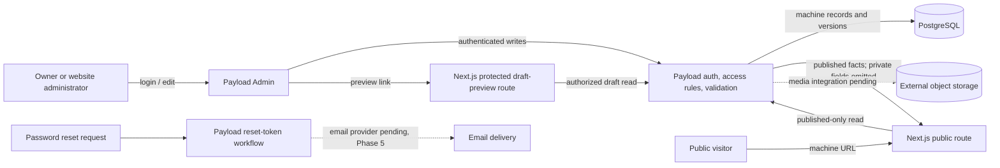

# Phase 2: Machine model and Payload owner workflow - Research

**Researched:** 2026-10-01  
**Domain:** Payload CMS 3, PostgreSQL inventory modelling, protected editorial workflow  
**Confidence:** MEDIUM

<user_constraints>
## User Constraints (from CONTEXT.md)

### Locked Decisions

### Machine identity and URLs
- **D-01:** Assign each physical machine a permanent sequential HGR ID beginning `HGR-000001` and increasing onwards. Never reuse an ID. Keep it separate from the manufacturer serial number. — **Reversibility:** one-way — replacing IDs after they have become machine records, public references, URLs, and staff references requires data migration and risks identity collisions.
- **D-02:** Use a public path such as `/machines/{seo-slug}-hgr-000001` (or an equivalent category path), always including the permanent HGR ID. Published URLs must remain stable. If a correction is necessary, retain a 301 redirect from the prior URL to the same physical machine. Never reuse a machine URL for another unit. — **Reversibility:** one-way — changing an established public URL affects shared links and search indexing, so preserve the historical route with a redirect.
- **D-03:** Assume there are no existing WordPress machine pages to migrate. If any are later discovered, inventory them before planning migration or redirects.
- **D-04:** Display the HGR ID as a small “Reference” field on the machine page; do not make it a prominent headline or selling detail. — **Reversibility:** reversible — presentation can be adjusted without changing machine identity or URLs.

### Publication, stock status, and publishing rules
- **D-05:** Keep Publication State separate from Stock Status. Publication State is Draft, Published, or Archived. Stock Status is Available, Reserved, or Sold. Draft is admin-only. Published Available is public; Published Reserved is public with a Reserved badge; Published Sold is public with a Sold badge. Archived is admin-only. Archiving is for withdrawn, duplicate, or obsolete listings and preserves the historical record and permanent machine ID. — **Reversibility:** costly — combining or changing these states later would require data migration and could expose drafts or hide published historical listings.
- **D-06:** Publishing requires HGR ID, Category, Brand, Model, Stock Status, a selected Featured Image, and at least one Gallery Image. Price (including Contact for Price), Year, Hours, specifications, serial number, attachments, and location are optional. Unknown optional facts remain blank; never invent values. — **Reversibility:** costly — changing the minimum later requires reviewing existing records and their publication state.
- **D-07:** A featured image may be selected from the gallery; do not require owners to upload a duplicate image solely to satisfy both roles. Keep serial-number storage private by default and its public visibility independent. Do not treat Category as a substitute for any approved machine facts.

### Staff access and recovery
- **D-08:** Provide two separate protected initial staff accounts: owner and website administrator. Use owner-controlled email password reset for account recovery. Configure email delivery later; Phase 2 planning/implementation must not provision an email service or require credentials. — **Reversibility:** costly — changing recovery depends on account ownership and the configured email delivery path.

### the agent's Discretion
- Use the simplest maintainable Payload model and owner-facing workflow that satisfies these decisions and MODL/ADMN requirements.
- Decide technical field grouping, validation wording, admin list/search/filter layout, safe default visibility, and implementation-level URL slug generation within the locked identity and URL rules.
- When local integration depends on absent PostgreSQL or object-storage services, complete independent local work and record infrastructure verification as pending. Do not create services or require Phase 1 external verification to continue.
</user_constraints>

<phase_requirements>
## Phase Requirements

| ID | Description | Research Support |
|----|-------------|------------------|
| MODL-01 [VERIFIED: .planning/REQUIREMENTS.md:26] | An administrator can create a distinct record with a unique internal ID for every physical machine, including otherwise identical brand/model/year units. | Permanent unique machine identity, database uniqueness, and duplicate prevention. |
| MODL-02 [VERIFIED: .planning/REQUIREMENTS.md:27] | A physical machine receives a unique stable public URL that is never assigned to a different unit, including after sale. | HGR ID in immutable URL identity; retain old path redirects if corrected. |
| MODL-03 [VERIFIED: .planning/REQUIREMENTS.md:28] | An administrator can record Available, Reserved or Sold independently of Draft or Published state. | Separate stock state from Payload draft/publication workflow. |
| MODL-04 [VERIFIED: .planning/REQUIREMENTS.md:29] | An administrator can enter supported machine facts, including Year of Manufacture separately from Registration Date and an explicitly verified Machine Origin / Registration Status. | Grouped structured fields; separate dates and explicit owner-entered origin claim. |
| MODL-05 [VERIFIED: .planning/REQUIREMENTS.md:30] | An administrator can choose a public RM price or Contact for Price for each unit; public outputs never treat a hidden price as zero. | Mutually exclusive price mode/value and public output rules. |
| MODL-06 [VERIFIED: .planning/REQUIREMENTS.md:31] | An administrator can store a serial number privately and independently approve whether its field value is publicly visible. | Field-level access plus public projection; default private and explicit visibility flag. |
| MODL-07 [VERIFIED: .planning/REQUIREMENTS.md:32] | The public machine data omits unknown optional facts instead of inventing values or claims such as Recond or Local New. | Leave optional fields nullable and omit blank values from public output. |
| MODL-08 [VERIFIED: .planning/REQUIREMENTS.md:33] | An administrator can manage normal structured page/contact content in Payload without code or a deploy. | Keep routine inventory and structured content in Payload-managed collections/globals. |
| ADMN-01 [VERIFIED: .planning/REQUIREMENTS.md:37] | The owner and a website administrator have two separate protected initial accounts. | One Payload authentication collection can host separate accounts; use controlled bootstrap and no committed credentials. |
| ADMN-02 [VERIFIED: .planning/REQUIREMENTS.md:38] | An administrator can recover account access through a protected recovery workflow. | Payload's built-in reset-token workflow; email delivery remains pending for Phase 5. |
| ADMN-03 [VERIFIED: .planning/REQUIREMENTS.md:39] | An administrator can find a unit by machine ID, brand or model in a usable inventory list. | Configure Payload admin searchable fields for those identifiers and a clear title/list view. |
| ADMN-04 [VERIFIED: .planning/REQUIREMENTS.md:40] | An administrator can create, edit and save a machine draft without making it public. | Payload versions/drafts with anonymous read constrained to published records. |
| ADMN-05 [VERIFIED: .planning/REQUIREMENTS.md:41] | An authorized administrator can preview a draft through a protected preview that does not expose it publicly. | Admin preview URL plus authenticated Next.js draft-mode endpoint and authorized draft read. |
| ADMN-10 [VERIFIED: .planning/REQUIREMENTS.md:46] | Routine Sold status does not delete the unit or permit accidental reuse of its public URL. | Deny routine deletes, disable duplication, preserve permanent ID and URL identity. |
</phase_requirements>

## Summary

Use the existing Payload/PostgreSQL foundation to add one owner-facing Machine collection and a small authentication-enabled staff collection. Give each physical unit an immutable unique HGR ID independent of the manufacturer's serial number; include that ID in a stable public route. Keep stock status as its own field. Use Payload's version-backed draft and publish flow for editorial status, and represent archive as an admin-only lifecycle state without making Sold mean archived. [CITED: Payload collection configuration](https://payloadcms.com/docs/configuration/collections) [CITED: Payload drafts](https://payloadcms.com/docs/versions/drafts) [VERIFIED: .planning/phases/02-machine-model-and-payload-owner-workflow/02-CONTEXT.md:17-25]

The project already mounts Payload Admin and REST API routes and configures PostgreSQL, GCS, Sharp, environment checks, disabled automatic schema push, and an explicit migration directory. Extend those integration points; do not reinstall dependencies or apply migrations without a disposable database. The project owner has authorized local work while PostgreSQL, object storage, hosting and email remain pending. [VERIFIED: src/payload.config.ts:1-80] [VERIFIED: .planning/STATE.md:27-43,69-82] [VERIFIED: docs/development/dependency-review.md:1-22]

**Primary recommendation:** implement the data model, access rules, admin workflow and migrations on the existing Payload 3/PostgreSQL stack; make identity and sensitive-field protections server-enforced, and explicitly record database/media/email integration checks as pending.

## Architectural Responsibility Map

| Capability | Primary Tier | Secondary Tier | Rationale |
|------------|-------------|----------------|-----------|
| Permanent machine identity and structured facts | Database / Storage | API / Backend | PostgreSQL uniqueness and migration-defined schema protect identity; Payload validates writes. |
| Editorial publication, archive, stock state | API / Backend | Database / Storage | Payload access controls and validation govern API/Admin writes; persisted fields keep stock and editorial states separate. |
| Public URL resolution and redirects | Frontend Server (SSR) | API / Backend | The server resolves only publicly eligible units; the stable machine identity is persisted by Payload. |
| Staff login, recovery and role boundary | API / Backend | Frontend Server (SSR) | Payload auth and collection access protect Admin/API; reset email delivery is a later integration. |
| Private serial number | API / Backend | Database / Storage | Field access must omit the value from unauthorized API responses, with a public presentation layer that also excludes private data by default. |
| Featured/gallery image references | API / Backend | Database / Storage | Phase 2 needs publishing validation and references; category upload and processing remain Phase 3. |

## Standard Stack

### Core

| Library | Version | Purpose | Why Standard |
|---------|---------|---------|--------------|
| Payload CMS | 3.90.2 (locked project version) | Collections, authentication, Admin, APIs, validation, drafts and preview | Already the approved CMS and foundation integration; no new package is required. [VERIFIED: docs/development/dependency-review.md:1-16] |
| `@payloadcms/db-postgres` | 3.90.2 (locked project version) | PostgreSQL adapter and generated schema migrations | Existing adapter uses the approved portable PostgreSQL database. [VERIFIED: docs/development/dependency-review.md:8-16] |
| Next.js | 16.3.7 (locked project version) | Admin/API route host and later protected draft-preview endpoint | Existing app uses the App Router and already mounts Payload routes. [VERIFIED: docs/development/dependency-review.md:8-16; src/app/(payload)/admin/[[...segments]]/page.tsx:1-16; src/app/(payload)/api/[...slug]/route.ts:1-13] |
| TypeScript | 5.9.3 (locked project version) | Typed collection configuration and generated Payload types | Existing project standard. [VERIFIED: docs/development/dependency-review.md:8-16] |

### Supporting

| Library | Version | Purpose | When to Use |
|---------|---------|---------|-------------|
| `@payloadcms/storage-gcs` | 3.90.2 (locked project version) | Existing portable GCS adapter integration | Keep machine media on the existing external-storage seam; live bucket verification remains pending. [VERIFIED: docs/development/dependency-review.md:8-16; src/payload.config.ts:2,53-62] |
| Sharp | 0.35.5 (locked project version) | Existing Payload upload image handling | Use only for image behavior already configured; structured image workflows and derivative tuning are Phase 3. [VERIFIED: docs/development/dependency-review.md:8-16; src/payload.config.ts:6,49] |

No new package is recommended for this phase. Package legitimacy audit: not applicable because the phase should use the already installed dependency tuple and does not call for package installation. [VERIFIED: docs/development/dependency-review.md:1-22]

## Architecture Patterns

### System Architecture Diagram



### Recommended Project Structure

```text
src/
├── collections/
│   ├── Machines.ts       # Physical-unit fields, editorial/stock access and publish rules
│   ├── Users.ts          # Protected staff authentication and controlled account access
│   └── MachineMedia.ts   # Minimal image collection/references needed by publish validation
├── app/
│   ├── (payload)/admin/  # Existing Payload Admin route
│   └── (payload)/api/    # Existing Payload API route
└── migrations/           # Generated, reviewable PostgreSQL schema migrations
```

MachineMedia is a planning recommendation for the minimal publishable-image dependency, not a requirement to implement Phase 3's categories, processing, watermarks or document workflow here. Use a distinct real media collection; the existing `foundation-fixtures` collection is explicitly fake-only. [VERIFIED: src/collections/FoundationFixture.ts:3-18] [CITED: Payload uploads](https://payloadcms.com/docs/upload/overview)

### Pattern 1: Permanent identity separate from user-facing slug

**What:** Assign an immutable unique HGR reference on creation and generate the readable slug/path using that reference. Prevent manual ID editing and accidental duplication; retain the earlier URL if a correction changes the readable portion. [VERIFIED: .planning/phases/02-machine-model-and-payload-owner-workflow/02-CONTEXT.md:17-20]

**When to use:** For every physical machine, even when descriptive fields match another unit. [VERIFIED: .planning/REQUIREMENTS.md:26]

**Implementation guidance:** use a database-backed sequence/counter whose allocation is safe under concurrent creation, and enforce uniqueness in PostgreSQL. Do not derive permanent identity from make/model/year or manufacturer serial. Whether the formatted sequence should be allocated with a PostgreSQL sequence or an allocation table is an implementation detail to resolve against the project's migration tooling; no service-backed concurrency probe was possible here. [ASSUMED]

### Pattern 2: Editorial drafts with a separate inventory state

Payload's draft feature stores versions and manages its built-in `_status` for draft/published. The machine's Available/Reserved/Sold stock state remains an independent field. Archive should be a distinct admin-only state or archive marker; don't use Sold, delete, or unpublished as an archive substitute. Anonymous reads must be constrained to published, non-archived documents, while authenticated staff can read drafts and archived records. [CITED: Payload drafts](https://payloadcms.com/docs/versions/drafts) [VERIFIED: .planning/phases/02-machine-model-and-payload-owner-workflow/02-CONTEXT.md:22-25]

Payload's `draft: true` write option permits incomplete drafts, but it is not itself the publication state; `_status` indicates draft/published. Publishing requires explicit publish state and server-side validation of the required identity/category/model and selected image references. [CITED: Payload drafts](https://payloadcms.com/docs/versions/drafts) [VERIFIED: .planning/phases/02-machine-model-and-payload-owner-workflow/02-CONTEXT.md:22-25]

### Pattern 3: Two staff accounts, private-by-default values

Use one authentication-enabled staff collection for separate owner and administrator accounts unless a real permission difference requires roles. Restrict Admin access and all machine/media writes to authenticated staff. Bootstrap the first account through Payload's first-user setup and create the second through a protected staff workflow; do not seed actual credentials or make staff registration public. Payload supports auth collections, Admin access, reset flows, and login lockout configuration. [CITED: Payload Admin](https://payloadcms.com/docs/admin/overview) [CITED: Payload authentication](https://payloadcms.com/docs/authentication/overview) [CITED: Payload production abuse prevention](https://payloadcms.com/docs/production/preventing-abuse)

For serial data, default the public-visibility flag to false, deny unauthenticated reads of the serial field unless explicit approval is stored, and still construct the public machine projection from an allow-list. Field-level `read` access omits denied properties from Payload responses; collection-level `read` access controls whole-document visibility. [CITED: Payload field access](https://payloadcms.com/docs/access-control/fields) [CITED: Payload collection access](https://payloadcms.com/docs/access-control/collections)

### Pattern 4: Owner-manageable inventory list

Use Payload's built-in paginated collection list. Configure an understandable title and `admin.listSearchableFields` to cover the permanent ID, brand and model. Use normal structured text/number/date/select fields so routine updates don't require source changes. Payload runs configured field validation in both Admin and backend/API paths. [CITED: Payload collections](https://payloadcms.com/docs/configuration/collections) [CITED: Payload field validation](https://payloadcms.com/docs/fields/overview)

### Pattern 5: Versioned PostgreSQL schema

Add fields/collections in Payload config, generate and review a migration, and keep migration application behind an explicitly disposable database boundary. The existing config has `push: false` and an explicit `migrationDir`; Payload's PostgreSQL docs warn config changes require database schema updates and describe generated migration workflows. Do not apply an unapplied migration just to see whether it works when there is no disposable PostgreSQL. [VERIFIED: src/payload.config.ts:39-47] [VERIFIED: .planning/phases/02-machine-model-and-payload-owner-workflow/02-CONTEXT.md:64-73] [CITED: Payload PostgreSQL](https://payloadcms.com/docs/database/postgres) [CITED: Payload migrations](https://payloadcms.com/docs/database/migrations)

## Don't Hand-Roll

| Problem | Don't Build | Use Instead | Why |
|---------|-------------|---------|-----|
| Staff login, sessions and reset tokens | Custom password storage, cookies or reset-token code | Payload auth-enabled staff collection and built-in auth operations | Payload provides login/session and reset workflow primitives. [CITED: Payload authentication](https://payloadcms.com/docs/authentication/overview) |
| Field/collection permission enforcement | Frontend-only hiding of drafts, serial numbers or admin buttons | Payload collection and field access controls, then a public allow-list projection | Access rules protect Admin/API operations and denied fields can be omitted from API responses. [CITED: Payload access control](https://payloadcms.com/docs/access-control/overview) [CITED: Payload field access](https://payloadcms.com/docs/access-control/fields) |
| Draft versioning and preview plumbing | A parallel hand-built draft store | Payload Versions/Drafts and its preview hook-up, with a protected Next.js draft endpoint | Payload versions provide the draft/publish model and preview integration. [CITED: Payload drafts](https://payloadcms.com/docs/versions/drafts) [CITED: Payload preview](https://payloadcms.com/docs/admin/preview) |
| Database schema evolution | Ad hoc startup DDL or automatic push against unknown databases | Payload's generated PostgreSQL migrations, reviewed before use | The project's explicit `push: false` and migration history are existing safety boundaries. [VERIFIED: src/payload.config.ts:39-47; src/migrations/index.ts:1-8] [CITED: Payload migrations](https://payloadcms.com/docs/database/migrations) |

**Key insight:** this phase's costly mistakes are identity reuse and accidentally exposing unpublished or private data. Keep the unique physical identity, public eligibility, stock status and field visibility as separate persisted concerns.

## Common Pitfalls

### Pitfall 1: Letting a mutable slug become identity

**What goes wrong:** changing a model description or slug changes the machine's public identity or a sold machine's URL is reused.  
**Why it happens:** a slug is easy to generate from brand/model/year, which is not unique across physical units.  
**How to avoid:** every public route includes the immutable unique HGR ID; redirect an old corrected path to the same unit.  
**Warning signs:** duplicate-path tests rely only on brand/model/year or sold records are deleted. [VERIFIED: .planning/phases/02-machine-model-and-payload-owner-workflow/02-CONTEXT.md:17-20,22-25]

### Pitfall 2: Treating stock state as publication state

**What goes wrong:** a reserved or sold machine disappears, or a draft becomes public because a stock status changes.  
**Why it happens:** one generic `status` field is made to carry editorial and business meanings.  
**How to avoid:** Payload `_status`/drafts control editorial publication, an independent stock field controls Available/Reserved/Sold display, and archive remains a separate admin-only concept.  
**Warning signs:** Sold automatically triggers unpublish/delete; archive changes stock state. [VERIFIED: .planning/phases/02-machine-model-and-payload-owner-workflow/02-CONTEXT.md:22-25] [CITED: Payload drafts](https://payloadcms.com/docs/versions/drafts)

### Pitfall 3: Draft protection exists only in the UI

**What goes wrong:** an anonymous API request or preview URL can retrieve unpublished values.  
**Why it happens:** the Admin preview button is protected but backend collection access or draft-mode entry is not.  
**How to avoid:** constrain public collection reads to published records and gate draft mode with an authenticated preview mechanism; test both REST and direct page access.  
**Warning signs:** public queries use `draft: true`, or preview tokens/secret are not validated server-side. [CITED: Payload drafts](https://payloadcms.com/docs/versions/drafts) [CITED: Payload preview](https://payloadcms.com/docs/admin/preview)

### Pitfall 4: Serial number is hidden only in page markup

**What goes wrong:** serial data remains accessible from REST/GraphQL or a later public renderer.  
**Why it happens:** developers remove the field visually but leave API-level read access open.  
**How to avoid:** field-level read/write access with false-by-default visibility, plus public projection allow-list. Never let public visibility be inferred from category, photo or document values.  
**Warning signs:** anonymous API response contains serial values even when the page does not show them. [CITED: Payload field access](https://payloadcms.com/docs/access-control/fields)

Private text-field access does not hide a serial number legible in a public chassis/serial-plate photograph. Phase 3 must review image publication alongside serial privacy and retain any private original separately. [CITED: docs/planning-analysis/RECONCILIATION-REPORT.md:284-288]

### Pitfall 5: Contact for Price accidentally serializes as RM 0

**What goes wrong:** a missing price is shown as zero or an invalid public number.  
**Why it happens:** price is treated as a nullable numeric field without a separate presentation mode.  
**How to avoid:** validate the combination of a price mode and amount; public rendering returns either a real RM amount or Contact for Price, and leaves the amount absent otherwise. [VERIFIED: .planning/REQUIREMENTS.md:30-32]

### Pitfall 6: Treating local config build as database integration proof

**What goes wrong:** the phase reports migrations, uploads, account recovery or public visibility as proven despite no live services.  
**Why it happens:** config/type checks don't exercise PostgreSQL, GCS or delivered email.  
**How to avoid:** separate code/model checks from disposable DB/media/email integration and keep unavailable proof explicitly pending. [VERIFIED: .planning/STATE.md:27-43,69-82]

## Code Examples

Verified Payload patterns from official documentation; machine-specific names and rules below should be implemented to the locked requirements.

### Drafts and anonymous published-only reads

```typescript
import type { CollectionConfig } from 'payload'

export const Example: CollectionConfig = {
  slug: 'example',
  versions: { drafts: true },
  access: {
    read: ({ req }) => req.user
      ? true
      : { _status: { equals: 'published' } },
  },
  fields: [{ name: 'title', type: 'text', required: true }],
}
```

Source: [Payload draft access example](https://payloadcms.com/docs/versions/drafts). The machine collection must additionally exclude archived records from anonymous queries.

### Admin list search

```typescript
admin: {
  useAsTitle: 'machineId',
  listSearchableFields: ['machineId', 'brand', 'model'],
}
```

Source: [Payload collection Admin options](https://payloadcms.com/docs/configuration/collections). This uses existing Payload configuration, not another search dependency.

### Protected preview shape

```typescript
admin: {
  preview: (doc) => `/api/preview?path=${encodeURIComponent(`/machines/${doc.slug}`)}`,
}
```

Source: [Payload preview](https://payloadcms.com/docs/admin/preview). The route must validate an unguessable server secret, enter Next.js Draft Mode, and never return draft data to requests without a valid preview session; keep any secret in environment configuration.

### Independent field visibility

```typescript
{
  name: 'serialNumber',
  type: 'text',
  access: {
    read: ({ req, doc }) => Boolean(req.user) || doc?.serialNumberPublic === true,
    update: ({ req }) => Boolean(req.user),
  },
}
```

Source pattern: [Payload field access](https://payloadcms.com/docs/access-control/fields). The actual schema must define `serialNumberPublic` default false and ensure only staff can update it. Keep the field out of public projections unless explicitly approved.

## State of the Art

| Old Approach | Current Approach | When Changed | Impact |
|--------------|------------------|--------------|--------|
| Rebuild draft storage and edit/publish buttons independently | Payload versions with built-in draft/publish operations | Current Payload 3 docs | Less custom state machinery; draft API access must still be explicitly restricted. [CITED: Payload drafts](https://payloadcms.com/docs/versions/drafts) |
| Depend on development auto-push for every environment | Generate and apply explicit migrations for schema changes | Project foundation policy | Migrations remain portable and reviewable; local integration still requires a disposable PostgreSQL. [VERIFIED: src/payload.config.ts:39-47] [CITED: Payload migrations](https://payloadcms.com/docs/database/migrations) |

**Deprecated/outdated:** No phase-specific deprecated library or migration pattern was established in this research. Do not introduce legacy package alternatives; the exact approved package tuple is already installed. [VERIFIED: docs/development/dependency-review.md:1-22]

## Assumptions Log

| # | Claim | Section | Risk if Wrong |
|---|-------|---------|---------------|
| A1 | Allocate the sequential HGR reference using a PostgreSQL sequence or allocation table with uniqueness enforced in the database. | Architecture Patterns | A naive counter can race under concurrent creates or reuse a value after failed/deleted records. |
| A2 | A single staff auth collection is enough for owner and website administrator until the owner specifies different permissions. | Architecture Patterns | If admin staff must have narrower permissions, the schema needs role-specific access rules. |
| A3 | Phase 2 needs only a minimal real media collection/reference seam; structured photo categories, derivatives, and watermarks remain Phase 3. | Recommended Project Structure | Phase 2's publishing criteria require gallery references, while storage/category behavior is unfinished. |
| A4 | Treat the initial Category vocabulary as an implementation decision; `Excavator` is the likely first choice but this research found no authoritative exhaustive list. | Open Questions | A too-small or ambiguous set can constrain future heavy-equipment inventory. |
| A5 | Store RM amounts as numeric values validated separately from the Contact for Price mode; confirm whether fractional RM values are allowed before locking storage precision. | Common Pitfalls | Wrong precision can require a later data migration or inconsistent display. |

## Open Questions

1. **What exact values should Category offer initially?** Context makes Category required but doesn't define a taxonomy. Recommendation: support the current excavator inventory simply, keep category separately editable, and confirm the first allowed value before implementation. [VERIFIED: .planning/phases/02-machine-model-and-payload-owner-workflow/02-CONTEXT.md:22-25] [ASSUMED]
2. **Do owner and website administrator need different capabilities?** Recommendation: start with the least-complex shared staff permissions unless the business needs an owner-only control; keep role support easy to add. [CITED: Payload Admin RBAC](https://payloadcms.com/docs/admin/overview) [ASSUMED]
3. **How should the required gallery references work before Phase 3 photo-category processing?** Recommendation: define minimal machine image upload/reference support sufficient for publish validation, and leave category uploads/processing to Phase 3. Because no disposable GCS/PostgreSQL services exist, mark actual upload and migration verification pending. [VERIFIED: .planning/phases/02-machine-model-and-payload-owner-workflow/02-CONTEXT.md:22-25,96-99] [VERIFIED: .planning/STATE.md:75-82]
4. **Should registration date allow a partial date?** Requirement says the date is separate from year of manufacture but gives no precision rule. Recommendation: confirm whether month/day are known; use a date field only when HGR has an actual registration date, leaving it blank otherwise. [VERIFIED: .planning/REQUIREMENTS.md:29-33] [ASSUMED]

## Environment Availability

| Dependency | Required By | Available | Version | Fallback |
|------------|------------|-----------|---------|----------|
| Node.js | Local project checks | ✓ | 24.21.0 | — |
| npm | Existing dependency tooling | ✓ | 11.19.0 | — |
| PostgreSQL/disposable database | Migration application and live Payload/Admin integration | ✗ / pending | — | Continue schema/config work; do not apply migrations; repeat integration when an approved disposable service is available. |
| GCS/object-storage endpoint | Live image upload and media read verification | ✗ / pending | — | Define adapter/config and image-reference model; do not provision storage. |
| Email delivery | Password-reset delivery test | ✗ / pending | — | Implement against Payload's reset workflow; verify delivery only after Phase 5 approves/configures email. |

`psql` and `gcloud` are not available in the current shell. Phase 1 records that no PostgreSQL/object-storage service is available and no email or hosting resource should be provisioned. [VERIFIED: .planning/STATE.md:75-82]

**Missing dependencies with no fallback:** live schema, upload, and reset-email integration checks remain pending; this does not block independent local model/config planning or work.

**Missing dependencies with fallback:** use existing configuration/type/safety checks and synthetic records until approved disposable service endpoints are available.

## Validation Architecture

### Test Framework

| Property | Value |
|----------|-------|
| Framework | Node.js built-in test runner, using `node:test` [VERIFIED: tests/foundation-config.test.mjs:1-3; tests/smoke-environment.test.mjs:1-3] |
| Config file | None detected; tests are `.mjs` files using built-in Node test APIs. [VERIFIED: tests/foundation-config.test.mjs:1-3] |
| Quick run command | `node --test tests/foundation-config.test.mjs` [ASSUMED] |
| Full suite command | `node --test tests/*.test.mjs` [ASSUMED] |

The package currently defines `typecheck` as `tsc --noEmit`; the repository currently has foundation configuration and disposable-smoke tests, not Phase 2 behavior tests. [VERIFIED: package.json:4-10] [VERIFIED: tests/foundation-config.test.mjs:1-3; tests/smoke-environment.test.mjs:1-3]

### Phase Requirements → Test Map

| Req ID | Behavior | Test Type | Automated Command | File Exists? |
|--------|----------|-----------|-------------------|-------------|
| MODL-01, MODL-02, ADMN-10 | Unique immutable HGR identity, ID-bearing stable URL, no accidental duplicates/deletes | unit + disposable PostgreSQL integration | Add phase-specific `node:test`; live DB case only when disposable PostgreSQL is approved/available | ❌ Wave 0 |
| MODL-03 | Stock status independent from editorial publication | unit | phase-specific `node:test` for all combinations | ❌ Wave 0 |
| MODL-04, MODL-07 | Known structured facts; separate year/registration date; no inferred origin or unknown output | unit | phase-specific `node:test` on normalized public projection | ❌ Wave 0 |
| MODL-05 | Price and Contact for Price behavior never turns blank into zero | unit | phase-specific `node:test` for valid/invalid combinations | ❌ Wave 0 |
| MODL-06 | Private serial omitted unless visibility explicitly approved; write control is staff-only | access integration + unit | Payload access test once a test harness/disposable DB exists | ❌ Wave 0 |
| MODL-08 | Normal structured data editable through Admin/API configuration | config/type check + manual Admin workflow | `npm run typecheck`; manual workflow after DB available | Partial: foundation config test only |
| ADMN-01, ADMN-02 | Separate accounts; reset request/token flow; no public registration | auth integration + manual email delivery | Local Payload auth flow; actual email delivery pending Phase 5 | ❌ Wave 0 |
| ADMN-03 | Find machine by HGR ID, brand or model | Admin integration/manual | Manual search against synthetic inventory; add config assertion for searchable fields | ❌ Wave 0 |
| ADMN-04, ADMN-05 | Save unpublished draft and preview only in authorized session | access integration + manual browser check | Verify anonymous REST/page denied, staff preview works; requires DB and app runtime | ❌ Wave 0 |

### Sampling Rate

- **Per task commit:** phase-targeted `node:test` tests and `npm run typecheck` after a test harness exists. [ASSUMED]
- **Per wave merge:** full existing Node test suite plus phase tests; disposable PostgreSQL integration when available. [ASSUMED]
- **Phase gate:** verify with authenticated and anonymous paths; record unavailable live integrations without implying they passed. [VERIFIED: .planning/STATE.md:75-82]

### Wave 0 Gaps

- [ ] Add isolated tests for identity formatting/immutability, URL stability and archived/sold non-deletion.
- [ ] Add field/access tests for draft visibility, private serial number and explicit publication validation.
- [ ] Add machine fact/public projection tests for price mode, separate dates and omitted optional values.
- [ ] Define a safe disposable PostgreSQL integration harness before applying generated schema migrations.
- [ ] Add a browser-level owner workflow check for Admin list search, draft save, protected preview and two distinct accounts once a disposable DB is available.

## Security Domain

`security_enforcement` is enabled and `security_asvs_level` is 1 in `.planning/config.json`; use the phase-appropriate controls below. [VERIFIED: .planning/config.json:46-50]

### Applicable ASVS Categories

| ASVS Category | Applies | Standard Control |
|---------------|---------|-----------------|
| V2 Authentication | Yes | Use Payload auth for separate staff identities, login lockout and reset tokens; don't add public account registration. [CITED: Payload authentication](https://payloadcms.com/docs/authentication/overview) |
| V3 Session Management | Yes | Use Payload-managed sessions/tokens; test sign-in, sign-out, expiry and reset behavior. [CITED: Payload authentication](https://payloadcms.com/docs/authentication/overview) |
| V4 Access Control | Yes | Protect Admin/API operations, drafts, archived records and private field reads server-side. [CITED: Payload access control](https://payloadcms.com/docs/access-control/overview) |
| V5 Input Validation | Yes | Use field types/constraints and server-side validation for cross-field publish rules. [CITED: Payload fields](https://payloadcms.com/docs/fields/overview) |
| V6 Cryptography | Yes | Rely on Payload/platform password and token primitives; never hand-roll password hashing or reset-token cryptography. [CITED: OWASP ASVS areas](https://devguide.owasp.org/en/03-requirements/05-asvs/) [CITED: Payload auth operations](https://payloadcms.com/docs/authentication/operations) |

OWASP's current developer guide lists V2 Authentication, V3 Session Management, V4 Access Control, V5 Validation/Sanitization/Encoding and V6 Stored Cryptography among ASVS areas; the project's ASVS setting separately sets the target level. [CITED: OWASP Developer Guide ASVS](https://devguide.owasp.org/en/03-requirements/05-asvs/)

### Known Threat Patterns for Payload + Next.js

| Pattern | STRIDE | Standard Mitigation |
|---------|--------|---------------------|
| Anonymous draft or archive reads through Payload APIs | Information Disclosure | Collection read access returns only published/non-archived documents to anonymous requests; verify REST and frontend. |
| Serial number or private original exposure | Information Disclosure | Field-level read access and public allow-list; private-by-default visibility. Phase 3 owns JPJ document storage and derivative approval. |
| Guessed/forged draft preview link | Spoofing / Information Disclosure | Server validates preview secret/session before Next.js Draft Mode; keep secret in environment config. |
| Unauthenticated machine or staff mutation | Tampering / Elevation of Privilege | Restrict create/update/archive operations to authenticated staff; test API and Admin access. |
| Failed-login or reset abuse | Denial of Service / Spoofing | Configure Payload login lockout and reset-request throttling; avoid revealing account secrets. |
| Malformed facts or invalid price combinations | Tampering | Backend field validation and cross-field publication validation; never trust client-only checks. |

## Project Constraints (from AGENTS.md)

- Keep the approved Next.js, Payload, PostgreSQL and external object-storage design. Do not use Exabytes MariaDB or design around Exabytes-specific paths/features. Keep host, database and storage portable through environment variables. [VERIFIED: AGENTS.md; src/payload.config.ts:20-62]
- The business owner must perform routine content/inventory work in Payload Admin without code, terminal or deploy access. Use simple structured fields and useful Admin labels. [VERIFIED: AGENTS.md]
- Model physical machines as distinct stable records; sold machine pages and IDs remain reserved. Keep manufacturer serial private by default and independently visible only after explicit approval. [VERIFIED: AGENTS.md; .planning/phases/02-machine-model-and-payload-owner-workflow/02-CONTEXT.md:17-25]
- Keep Year of Manufacture separate from Registration Date and require HGR to enter/verify Machine Origin / Registration Status; do not infer Recond, Local New or missing facts. [VERIFIED: AGENTS.md; .planning/REQUIREMENTS.md:29-33]
- Never commit passwords, API keys, database credentials, service-account credentials, private keys or `.env` secrets. Keep `.env` files out of Git and provide only variable names in `.env.example`. [VERIFIED: AGENTS.md]
- Use synthetic disposable data for local integration. Do not provision services, alter production infrastructure, create paid resources or apply schema changes to an unknown/non-disposable database. [VERIFIED: AGENTS.md; .planning/STATE.md:75-82]
- Keep phase boundaries: Phase 3 owns structured photo categories, processing, watermarks and JPJ workflows; Phase 4 owns polished public inventory/detail pages and copy-link actions; Phase 5 owns email-provider setup. [VERIFIED: .planning/phases/02-machine-model-and-payload-owner-workflow/02-CONTEXT.md:96-99]
- Follow TypeScript, accessibility, KISS, least privilege, upload/input validation and focused maintainable component conventions. [VERIFIED: AGENTS.md]

## Sources

### Primary (HIGH confidence for in-repo facts; official docs are MEDIUM confidence)

- `.planning/phases/02-machine-model-and-payload-owner-workflow/02-CONTEXT.md` — locked machine identity, URL, stock/editorial state, publish validation, staff account and phase boundary decisions.
- `.planning/REQUIREMENTS.md` — Phase 2 MODL/ADMN requirement definitions.
- `.planning/STATE.md` — Phase 1 local/infrastructure verification status and approved pending work.
- `src/payload.config.ts`, `src/collections/FoundationFixture.ts`, `src/app/(payload)/admin/[[...segments]]/page.tsx`, `src/app/(payload)/api/[...slug]/route.ts`, `src/migrations/` — current implementation seams and fake-data boundary.
- `docs/development/dependency-review.md` — approved installed dependency tuple.
- [Payload Collections](https://payloadcms.com/docs/configuration/collections), [Access Control](https://payloadcms.com/docs/access-control/overview), [Field Access](https://payloadcms.com/docs/access-control/fields), [Drafts](https://payloadcms.com/docs/versions/drafts), [Preview](https://payloadcms.com/docs/admin/preview), [Authentication](https://payloadcms.com/docs/authentication/overview), [Postgres](https://payloadcms.com/docs/database/postgres), [Migrations](https://payloadcms.com/docs/database/migrations), [Uploads](https://payloadcms.com/docs/upload/overview) — current official Payload docs checked 2026-10-01.
- [OWASP Developer Guide: ASVS](https://devguide.owasp.org/en/03-requirements/05-asvs/) — applicable verification category names.

### Secondary (MEDIUM confidence)

- No secondary non-official sources used.

### Tertiary (LOW confidence)

- No tertiary sources used; remaining implementation choices are explicitly listed as assumptions.

## Metadata

**Confidence breakdown:**
- Standard stack: HIGH — checked against the repository's approved locked dependency review; no new packages recommended.
- Architecture: MEDIUM — official Payload docs support the patterns, but no PostgreSQL/GCS integration could be exercised.
- Pitfalls: MEDIUM — grounded in phase decisions, project state and official access/draft behavior.

**Research date:** 2026-10-01  
**Valid until:** 2026-10-31 for the stable Payload collection patterns; check official docs again before execution if the locked dependency version changes.
