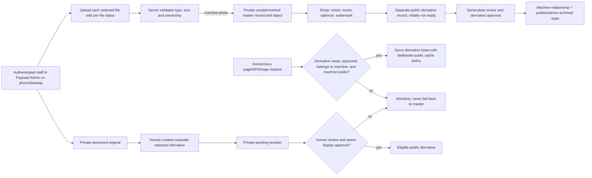

# Phase 3: Photography, media processing and JPJ protection - Research

**Researched:** 2026-10-01  
**Domain:** Payload uploads, image derivatives, private document authorization, and staff media workflows  
**Confidence:** HIGH for existing code and documented library behavior; MEDIUM for the proposed integration design pending service-backed verification

<user_constraints>
## User Constraints (from CONTEXT.md)

### Locked Decisions

These locked decisions are the approved scope for Phase 3. They do not authorize provisioning external services or using real private documents.

### Photo storage and public delivery
- **D-01:** Keep unwatermarked source photos staff-only and create separate public derivative records. Public file delivery must check that the derivative belongs to the physical machine, is ready and approved for use, and is referenced by a Published, non-archived machine. Never make a master publicly readable merely to deliver its derivatives. This follows approved private-master/public-derivative requirements and Sol's Phase 3 privacy review.
- **D-02:** Preserve all 12 existing photography categories. A machine may publish with only its required suitable featured/general image; no other category is mandatory. Reordering changes gallery order without changing a photo's stable identity or generated storage name.
- **D-03:** Retain originals and make watermark treatment centrally configurable for No Watermark, HGR Logo, and HGR Logo + domain, including placement, size, opacity and margin. Do not invent or generate HGR artwork; keep watermark artwork/default settings unapproved until the owner supplies or approves them.
- **D-04:** Treat current upload caps and real batch performance as unverified. Keep limits configurable; do not impose a 200 KB owner-upload target. Use representative synthetic batches and recoverable per-file errors in local validation; record actual size limits, retention/regeneration policy and storage performance for confirmation with approved services.

### JPJ and serial privacy
- **D-05:** Keep document originals, private previews and pending redacted copies staff-only. Store a redacted copy separately and do not expose it until a human reviewer has approved that specific file revision and explicit owner approval for public display is recorded. Replacing the copy invalidates approval. Keep document availability approval separate from file-display approval. A human review must consider visible content and embedded text/metadata; automated redaction alone is insufficient.
- **D-06:** Do not grant approval authority to a role by assumption. This constraint is resolved by D-08: the Owner role initially receives the explicit `Approve Public Documents` permission; do not hard-code publication to a role check. Keep public document display denied until the permission check, required review and publication action succeed.
- **D-07:** Keep private serial values out of public projections unless independently enabled. Require human review of any image where a plate may be readable, across all photo categories. A photo replacement or serial-visibility change must invalidate affected review state.

### Owner-approved public-document and photo-review policy
- **D-08:** Use a permission named `Approve Public Documents`, initially assigned only to the Owner role. Store/check the named permission independently of role-specific publication logic so a future role can receive it without database-schema or business-logic changes. Administrators may upload documents, redact them, save drafts and submit them for Owner review; they cannot publish. Enforce this server-side for Payload Admin actions and direct API requests.
- **D-09:** A user with `Approve Public Documents` publishes with one `Publish` action. That action records approval and publication together; there is no separate approval button. Persist `approved_by`, `approved_at`, `published_by` and `published_at` as distinct values, even when actor and time normally match. Before publication, the Owner can use `Preview as Public` to inspect the exact currently redacted public version; preview remains private and does not publish.
- **D-10:** Every new machine photo starts at `Needs Review`. A human reviewer checks for manufacturer serials, chassis/VINs, engine numbers, registration numbers, QR codes, barcodes, customer labels, delivery information, personal information and any other sensitive identifiers. If sensitive information exists, blur or crop it and repeat the review before publication. If uncertain, escalate to the Owner. AI may highlight possible sensitive areas only; it never substitutes for human review or takes final responsibility.
- **D-11:** Preserve permanent audit history for upload, redaction, approval, publication and modification. Record `uploaded_by`, `uploaded_at`, `redacted_by`, `redacted_at`, `approved_by`, `approved_at`, `published_by`, `published_at`, `last_modified_by` and `last_modified_at` where applicable. Never overwrite historical events; append immutable audit records and keep approval/publication as separate event types and current fields.

### the agent's Discretion
- Select the simplest Payload/Next.js implementation that satisfies these boundaries, existing portability requirements and current approved dependency tuple.
- Prefer manual upload of an already redacted derivative for this phase; do not introduce AI redaction or a new paid service.
- Keep unknown artwork, upload-limit, retention and document-format details as explicit TO CONFIRM items, with safe-deny behavior until resolved. The Owner permission and Publish/preview workflow are approved and are not pending decisions.
- AI-assisted highlighting is optional and is not required for Phase 3; do not add an AI service or allow AI to clear the human review state.

### Deferred Ideas (OUT OF SCOPE)

None — discussion stayed within Phase 3 scope.
</user_constraints>

<phase_requirements>
## Phase Requirements

| ID | Description | Research Support |
|----|-------------|------------------|
| ADMN-06 | An administrator can publish and unpublish a unit after understandable minimum-field validation, including a suitable featured/general photo. | Preserve machine eligibility checks, but gate publication of public document copies through the named permission and one server-enforced Publish action; an administrator without the permission cannot publish a public document. |
| ADMN-09 | An administrator can perform normal inventory editing and photo upload from a phone with understandable progress, validation and recoverable errors. | A representative mobile upload workflow must track each file independently and recover from partial failure; batch throughput remains an environment-specific validation item. |
| IMAG-01 | An administrator can add machine photographs under the 12 current structured categories: General / Exterior, Side View 1, Side View 2, Front View, Rear View, Cabin / Interior, Hour Meter, Chassis / Serial Number, Engine, Undercarriage / Tracks, Boom / Arm / Bucket and Other / Details. | Use a typed category field and a unified ordered gallery; category names quoted from `.planning/REQUIREMENTS.md:50-50`. |
| IMAG-02 | An administrator can upload multiple images in a category, choose a featured image, reorder images and preview them without completing every category. | Per-photo records with stable IDs; gallery order and featured assignment belong to machine/photo relationship state, not object name. |
| IMAG-03 | Where supported, an administrator can set a focal point for a photograph without changing its preserved master. | Payload focal-point fields appear when image sizes/resizing are configured; derivation must operate from the untouched master. |
| IMAG-04 | An administrator can upload good-quality originals without manually resizing each file; an appropriate master is retained. | Retain a private original record, then create derivative records from it. |
| IMAG-05 | Public machine images are automatically oriented, resized and optimized into responsive derivatives; ordinary visitors are not served multi-megabyte originals. | Sharp provides EXIF auto-orientation and format/resize operations; serve only derivative URLs through public projection. |
| IMAG-06 | Public generated machine-image filenames use stable machine identity, photo category and sequence rather than trusting the uploader filename. | Generate deterministic names from machine reference, category, and stable per-photo sequence; don't use reorder position as sequence. |
| IMAG-07 | An administrator can set factual image alt text separately from the filename without invented visual details. | Keep alt text as a separate editable field; no automatic visual claims. |
| IMAG-08 | The system can generate public derivatives with centrally configurable No Watermark, HGR Logo or HGR Logo + domain treatment, including placement, size, opacity and margin; original masters remain unwatermarked. | Use Sharp compositing against derivative buffers and centrally stored settings; artwork/defaults require owner confirmation. |
| IMAG-09 | Representative batches of approximately 10–30 images per machine can complete or report recoverable processing errors without a rigid ~200 KB owner-upload limit. | Upload/process files independently or with bounded concurrency, persist per-file state/errors, and verify batches with synthetic images; exact file/batch limits remain unconfirmed. |
| JPJD-01 | Authorized staff can store a JPJ or ownership document original separately from public machine photos and documents. | Separate private upload collection/object prefix and document state from photo assets. |
| JPJD-02 | Anonymous visitors and public API/media requests cannot fetch private document originals or their private derivatives. | Keep Payload access control enabled; verify direct static URL, REST API, app route, Next image optimizer, and cached/proxy paths. |
| JPJD-03 | Authorized staff can create or upload a separate redacted public derivative without overwriting its private original. | Manual upload of a separate derivative is within scope; maintain a revision link/hash and distinct storage identity. |
| JPJD-04 | A human reviewer must explicitly approve a redacted derivative before any public display; pending or rejected copies are not exposed. | The named-permission holder uses one Publish action; server-side transition records approval and publication distinctly against the exact revision; replacement revokes eligibility. |
| JPJD-05 | Staff can see and change a document's not-uploaded, uploaded, pending-review or approved state without code. | Administrators can upload, redact, draft and submit, but only `Approve Public Documents` authorizes Publish; permission checks are independent of role tests. |
| JPJD-06 | A public machine page can state document availability or display the redacted derivative only when the corresponding statement or copy is approved. | Keep availability approval separate from file-display approval; only the Publish action exposes the approved revision. Owner preview remains private/no-store. |
| JPJD-07 | Public photography and data exposure respect a private serial number, including review of readable chassis/serial plate images before publication. | Start each image at `Needs Review`; human checklist covers all categories, edits require re-review, uncertainty escalates to Owner; optional AI only highlights. |

## Decision Acceptance Mapping (D-08–D-11)

| Decision | Planning consequence |
|----------|---------------------|
| D-08 | Add a named permission capability and assign it initially only to Owner. Authorize by permission membership, not `role === "owner"`; enforce on Admin publish operation and REST/GraphQL/direct server mutation paths. Keep upload, redaction, draft and submission rights available to staff administrators. |
| D-09 | Replace a separate approval control with one permission-gated Publish action. In the same successful transition, persist separate `approved_by`, `approved_at`, `published_by`, `published_at`; provide permission-gated Preview as Public for the exact redacted revision with private authorization and `Cache-Control: no-store`. |
| D-10 | Initialize each new machine photo in `Needs Review`; store human review outcome/reviewer/time and checklist result per revision. Redaction/replacement resets to `Needs Review`; uncertainty escalates to Owner. AI highlighting may be omitted and can never change state or publish. |
| D-11 | Append one immutable lifecycle event per upload, redaction, approval, publication and modification as applicable; event types remain separate even when one Publish action creates approval and publication events. Store the exact requested actor/time fields in current state where applicable and in historical events. Never accept audit actor/timestamps as client-authored values. |
</phase_requirements>

## Summary

Phase 3 should extend the current staff-only `machine-media` upload as the private photo master, while adding distinct public derivative records and distinct JPJ/ownership-document records. The existing `MachineMedia` collection grants reads only to staff (`src/collections/MachineMedia.ts:13-18`), and the existing machine model points featured and gallery relations at this collection (`src/collections/Machines.ts:262-272`). [VERIFIED: src/collections/MachineMedia.ts:13-18; src/collections/Machines.ts:262-272] Payload upload collections already provide multipart upload, media validation hooks, access rules, focal-point support when resizing is configured, generated image sizes, and static-file access checks. Those features are useful building blocks, but the locked master/derivative boundary requires separate records and public authorization that considers machine ownership, processing readiness, explicit review/publication eligibility, and the machine's published/non-archived state. [CITED: https://payloadcms.com/docs/upload/overview] [CITED: https://payloadcms.com/docs/upload/storage-adapters]

Use the already-installed stack: Payload and its GCS adapter 3.90.2, Next.js 16.3.7, Sharp 0.35.5, with the existing PostgreSQL-backed schema and environment-supplied storage. Exact installed versions are in `package.json:17-33` (quoted: `"@payloadcms/storage-gcs": "3.90.2"`, `"next": "16.3.7"`, `"payload": "3.90.2"`, `"sharp": "0.35.5"`). Do not add a media service, redaction service, or package for this phase. The project's Node runtime is currently `">=22.23.3 <23 || >=24 <25"` (`package.json:6-8`); actual Exabytes upload/Sharp runtime compatibility and cloud integration remain unverified. [VERIFIED: package.json:6-8,17-33]

For large phone uploads, the key design issue is end-to-end request limits, not just image compression. The current Payload-wide per-file cap is 5 MiB and aborts over-limit uploads (`src/payload.config.ts:86-89`, quote: `limits: { fileSize: 5 * 1024 * 1024 }, abortOnLimit: true`). Payload also has request-wide multipart, count, and timeout limits; the complete batch must fit those limits if sent in one request. Prefer per-file requests with bounded concurrency and persisted per-file success/failure, or prove a different chunk strategy, instead of one all-or-nothing 10–30-file request. Do not freeze upload caps until synthetic phone-sized batch checks and later approved service tests establish them. [CITED: https://payloadcms.com/docs/upload/overview] [VERIFIED: src/payload.config.ts:86-89]

**Primary recommendation:** Use separate private master, public photo derivative, private document original, and pending/approved redacted-copy records. Keep GCS objects private and Payload access control active; serve a public derivative only after server-side authorization confirms D-01 and D-05/D-08 conditions. Implement `Approve Public Documents` as a permission capability independent of the current role field. Administrators may upload, redact, draft and submit; one Publish action, authorized by the permission at both Admin and API/server boundaries, records distinct approval and publication actor/time fields for the exact revision. Give the Owner a private, authenticated, no-store `Preview as Public` view of that exact revision. Keep photo review human-led, revision-bound and `Needs Review` by default, with optional AI limited to advisory highlighting. Append separate immutable audit events for lifecycle transitions; actor and times are server stamped. Use Sharp and central watermark settings; keep service, artwork, limit and retention checkpoints explicit and use synthetic data only.

## Architectural Responsibility Map

| Capability | Primary Tier | Secondary Tier | Rationale |
|------------|-------------|----------------|-----------|
| Staff category/photo editing, ordering, featured selection and preview | Browser / Client | API / Backend | Payload Admin needs phone-sized controls; the server persists category, ordering and ownership. |
| Upload validation, master retention and Sharp processing | API / Backend | Database / Storage | Server validates the uploaded bytes and transforms/stores protected assets. |
| Public responsive derivative delivery | API / Backend | CDN / Static | Each request must authorize the derivative relationship before bytes are delivered; public caching applies only to approved derivatives. |
| Watermark policy | API / Backend | Database / Storage | Central settings and deterministic server generation produce consistent derivatives. |
| JPJ original and pending redaction protection | API / Backend | Database / Storage | Authorization, document revision, review and approval are server-owned, with private bytes stored separately. |
| Permission-based publication and audit stamping | API / Backend | Browser / Client | Named permission checks and transition/audit writes must be enforced on every server/API path; UI only presents the authorized action. |
| Private `Preview as Public` | API / Backend | Browser / Client | Authenticated server-rendered/streamed preview shows one exact redacted revision without changing publication state or entering shared caches. |
| Human approval and serial-image review | Browser / Client | API / Backend | Reviewer sees the exact revision and checklist; server enforces review state, re-review and invalidation rules. |
| Portable media configuration | API / Backend | Database / Storage | Bucket/project/endpoint/credentials remain environment configuration, separate from application host. |

## Project Constraints (from AGENTS.md)

- Use Next.js, Payload CMS, PostgreSQL and external object storage; GCS is planned. Keep the app, DB and storage decoupled and portable; don't use Exabytes MariaDB or couple to Exabytes features. [VERIFIED: AGENTS.md; .planning/PROJECT.md]
- Do not provision storage/database services, spend money, use production infrastructure, publish documents, expose private information or use real JPJ documents without explicit approval. Use synthetic data until approved disposable services exist. [VERIFIED: AGENTS.md; .planning/phases/03-photography-media-processing-and-jpj-protection/03-CONTEXT.md]
- Routine business-owner media and inventory tasks must be possible in Payload without code or developer tools; use TypeScript, mobile-first responsive design, accessibility and simple maintainable patterns. [VERIFIED: AGENTS.md]
- Follow `MODEL-ROUTING.md`: Luna handles routine settled implementation; escalate privacy/security architecture, authentication/authorization, consequential schema choices and important security review to GPT-6.1 Sol. Model routing or Sol review does not grant owner approval or permission to provision services. [VERIFIED: MODEL-ROUTING.md]
- Keep secrets in environment configuration and out of Git. Validate upload content and user input; apply least privilege and do not expose internal machine data. [VERIFIED: AGENTS.md]
- Preserve stable physical-machine identity; sold status is separate from publication state. A suitable general/featured photo is required for publication, while other photo categories are optional. [VERIFIED: AGENTS.md; .planning/phases/03-photography-media-processing-and-jpj-protection/03-CONTEXT.md]
- Preserve masters; generate public responsive sizes; do not serve full originals as normal visitor assets. Use machine identity/category for generated names, with factual alt text separate. [VERIFIED: AGENTS.md; .planning/phases/03-photography-media-processing-and-jpj-protection/03-CONTEXT.md]
- JPJ originals remain private. Redacted derivatives are separate, never overwrite originals, and require human review plus explicit owner approval before public display. Do not rely on automated AI redaction. [VERIFIED: AGENTS.md; .planning/phases/03-photography-media-processing-and-jpj-protection/03-CONTEXT.md]
- Private serials must remain hidden unless explicitly enabled; don't infer business claims from document contents. Year of Manufacture and Registration Date remain separate fields. [VERIFIED: AGENTS.md; .planning/phases/03-photography-media-processing-and-jpj-protection/03-CONTEXT.md]
- Before significant implementation is complete, use relevant lint/type/test/build/accessibility checks and adversarial cases; this research task itself ran no tests as requested. [VERIFIED: AGENTS.md]

## Standard Stack

### Core

| Library | Version | Purpose | Why Standard |
|---------|---------|---------|--------------|
| Payload CMS + `@payloadcms/storage-gcs` | 3.90.2 (already installed) | Admin upload workflows, collection APIs/access, media adapter | Current project foundation already uses Payload upload collections, staff access and GCS storage. |
| Next.js | 16.3.7 (already installed) | App Router and Payload application | Existing app host/application foundation; use route handlers only where derivative/document delivery needs explicit checks. |
| Sharp | 0.35.5 (already installed) | EXIF orientation, resize, format conversion, watermark composition | Payload uses Sharp for image resizing; its documented operation APIs cover the needed transformations. |
| PostgreSQL adapter | 3.90.2 (already installed) | Persist media metadata, ownership, category/order, document revisions and review state | Existing project database and explicit migration pattern. |

### Supporting

| Library | Version | Purpose | When to Use |
|---------|---------|---------|-------------|
| `@payloadcms/next` | 3.90.2 (already installed) | Existing Admin/API integration with Next.js | Keep the current integration and reuse existing Admin/API mounts. |
| `@payloadcms/plugin-cloud-storage` | 3.90.2 transitive | Access-controlled GCS static file handling | Already installed under the official GCS adapter; retain Payload access checks for private masters and documents. |

### Alternatives Considered

| Instead of | Could Use | Tradeoff |
|------------|-----------|----------|
| Separate public derivative records | Payload image sizes on one public upload document | Image sizes are useful, but one collection access policy covers the upload document and its file delivery; this does not satisfy private-master/public-derivative separation on its own. |
| Manually supplied redacted image/PDF | Automated or AI redaction | Automation can miss identifiers, embedded text, or metadata; D-05/D-06 require human review and this phase explicitly prefers manual upload without new paid services. |
| Application-checked public delivery | Direct public GCS URLs for all files | Direct URLs bypass Payload collection access control. Keep object storage private and mediate each file class through the applicable authorization path. |

**Installation:** None. Reuse the locked, already-installed dependencies; no new external package is recommended.

**Version verification:** `package.json:17-33` was opened this session and fixes the installed direct package versions. `.planning/STATE.md` records the approved tuple; no package change or registry install is proposed. The registry/current-release version lookup was unavailable in this run, so these are **project-locked versions**, not claims that they are the newest releases. Official Payload installation and upload docs confirm Sharp as the integrated image processing mechanism. [CITED: https://payloadcms.com/docs/getting-started/installation] [VERIFIED: package.json:17-33]

## Architecture Patterns

### System Architecture Diagram



### Recommended Project Structure

```text
src/
├── collections/
│   ├── MachineMedia.ts              # private photo masters; extend with category/machine/order/review data
│   ├── MachinePhotoDerivatives.ts   # separate responsive public derivatives and readiness/approval state
│   ├── MachineDocuments.ts          # private original and document-availability workflow
│   └── MachineDocumentCopies.ts     # separate redacted revisions and approval metadata
├── app/api/media/                   # optional explicit authorization/file response handlers
├── lib/machines/
│   ├── access.ts                    # reuse/extend staff and published-machine access rules
│   ├── media.ts                     # deterministic names, eligibility and image processing helpers
│   └── documents.ts                 # revision-bound state transitions / projection helpers
└── migrations/                      # generated, reviewed, explicitly registered Payload migration
```

Structure is a planning proposal, not a claim that these new paths currently exist. Keep implementation proportional: if Payload's collection static handler can express the full D-01 relationship check, use it; add a custom handler only where the stock collection check cannot validate derivative-to-machine publication or revision-bound approval.

### Pattern 1: Private master, separate derivative

**What:** Save original image bytes in the existing staff-only upload collection. Generate optimized outputs from the master and persist each output as a separate derivative record that relates to the master, physical machine, category, and stable photo identity. The machine public projection includes only ready, approved derivative records. [CITED: https://payloadcms.com/docs/upload/storage-adapters]

**When to use:** Every machine photograph. Never store document files in the photo collection.

**Example:**

```typescript
// Pattern outline; file paths and field names are proposals, not existing schema.
const eligibility = await loadDerivativeWithAccessChecks(derivativeId);
if (!eligibility.ready || !eligibility.approved || !eligibility.belongsToMachine) {
  return notFound();
}
if (eligibility.machine.publication !== "published" || eligibility.machine.archived) {
  return notFound();
}
return streamFromConfiguredPrivateStorage(eligibility.objectKey, publicDerivativeHeaders);
```

The helper names, boolean fields, publication literal and response behavior above are illustrative `[ASSUMED]`; align them to actual Payload types when planning implementation.

Payload's cloud storage plugin keeps the default collection URL and static handler when Payload access control is enabled; direct GCS URLs bypass it. `next/image`'s default optimizer also does not forward source authorization headers, so it must not become a route around private-document checks. Use public output variants only for approved public assets, and reject private/pending files on route, API, optimizer, and cache paths. [CITED: https://payloadcms.com/docs/upload/storage-adapters] [CITED: https://nextjs.org/docs/pages/api-reference/components/image]

### Pattern 2: Structured gallery with stable identity

**What:** Give each photo one category and a stable ID/sequence; order and featured status are relationship/gallery metadata. Reordering changes display order only. Use these exact 12 category labels from `.planning/REQUIREMENTS.md:50-50`: `General / Exterior, Side View 1, Side View 2, Front View, Rear View, Cabin / Interior, Hour Meter, Chassis / Serial Number, Engine, Undercarriage / Tracks, Boom / Arm / Bucket and Other / Details`. [VERIFIED: .planning/REQUIREMENTS.md:50-50]

The allowed stock values are quoted verbatim from `src/collections/Machines.ts:214-222`: `options: ["Available", "Reserved", "Sold"].map((value) => ({ label: value, value: value.toLowerCase(), }))`. These remain independent from Draft/Published/Archived publication state. [VERIFIED: src/collections/Machines.ts:214-222]

Generate file names from HGR machine identity + category slug + a stable per-photo sequence/revision. Do not derive identity from current sort order; a reorder should not rename objects or invalidate external cache keys. Since image-size naming hooks operate within Payload uploads, if they're used for derivative records, compute names from persisted machine/category/photo metadata rather than uploader filenames. [CITED: https://payloadcms.com/docs/upload/overview]

### Pattern 3: Processing and revision state

**What:** On upload, validate bytes/MIME/size, persist the private master, and set derivative work pending. Generate all configured sizes from the master, apply orientation before geometry-dependent operations, apply watermark to outputs only, and mark each derivative ready only after all required writes succeed. Use a revision or source checksum so replacing the master invalidates stale derivative and serial-review state. [CITED: https://sharp.pixelplumbing.com/api-operation/] [CITED: https://sharp.pixelplumbing.com/api-output/]

**When to use:** Every new master, reprocessing run, or centrally changed watermark setting. Keep failed processing records recoverable; don't make partially-written files eligible for the public projection.

Add a review record keyed to derivative revision. Use the exact initial value `Needs Review` from D-10. Review UI should make the full human checklist explicit and record reviewer/time; only a human can clear it after inspecting the bytes that will be public. After a blur/crop or replacement, create a new derivative revision and reset review. AI-based highlighting is optional and out of Phase 3's dependency scope; if later added, output remains hints for the human and cannot transition the state. [CITED: `03-CONTEXT.md` D-10, copied verbatim above]

Payload's built-in focal-point selector requires image sizes or resize options. Configure suitable public size outputs first; Payload's crop affects the resized outputs, while the private master remains the regeneration source. [CITED: https://payloadcms.com/docs/upload/overview]

### Pattern 4: Per-file upload queue for phone batches

**What:** Select multiple photos, show their category and individual progress/state, send a bounded number of per-file requests, and allow failed files to be retried without re-uploading successful files. Persist upload/processing result separately from gallery order. Add clear file-size/type feedback, cancellation where safe, and a recovery path after network/app interruption. These UI details are a design recommendation; test them on real mobile browsers before declaring ADMN-09 complete. [ASSUMED]

**Why:** Current Payload config sets a 5 MiB per-file limit and `abortOnLimit: true`; Payload's documented request-wide multipart limit is separate and includes the whole request. A single 10–30 file multipart request could exceed the whole-request cap or fail the whole upload. Per-file requests avoid coupling successful files to the largest/failed one and make recoverability explicit. [CITED: https://payloadcms.com/docs/upload/overview] [VERIFIED: src/payload.config.ts:86-89]

### Pattern 5: Revision-bound document review

**What:** Keep the private original in a staff-only upload collection. Staff upload a separate redacted derivative into a distinct private pending collection. A human review records whether the exact redacted revision passes; the `Approve Public Documents` permission holder then uses the single `Publish` action, which records both `approved_by`/`approved_at` and `published_by`/`published_at` as distinct values. Do not add a separate approval button. Replacing bytes changes the revision and clears review and publication eligibility. Document availability approval remains distinct from file-display publication. Public projection includes only the currently published copy; pending/rejected state returns no file URL.

**When to use:** JPJ/ownership cards and any sensitive document. The Owner's `Preview as Public` must show the exact current redacted revision through an authenticated private path, without setting public status, emitting a public URL or entering shared caches. Apply `Cache-Control: no-store` to the preview document and byte response; keep it out of the public Next image optimizer and CDN. Private endpoints must authenticate staff and use access-respecting reads; don't expose public download links, temporary object URLs in logs, or signed URLs to the browser. A GCS signed URL is a bearer credential that works for anyone holding it until expiration, so don't use it for this preview unless Sol approves a specific short-lived pattern. [CITED: https://cloud.google.com/storage/docs/access-control/signed-urls] [CITED: https://nextjs.org/docs/app/guides/cdn-caching]

### Pattern 6: Permission-gated single Publish action

**What:** Model `Approve Public Documents` as a named capability stored independently on the user (for example, a persisted permission-name array), initially granted only to the Owner account. Implement `hasPermission(user, permission)` as the single policy helper; publication checks the permission value and does not branch on a role literal. Future assignment to another role/user then changes permission data rather than the schema or publication logic. Keep the existing role field as a separate staff/account classification. The current `Users.ts` role type is exactly `type StaffRole = "owner" | "website-administrator";` and its role options are exactly `{ label: "Owner", value: "owner" }` and `{ label: "Website Administrator", value: "website-administrator" }`. [VERIFIED: `src/collections/Users.ts:5-5,92-99`] Payload documents that Access Control is evaluated before operations and also drives Admin affordances using the same rules as APIs. Collection and field access rules can hide or deny editing, while collection `beforeChange` receives the request/data/original document for transition validation. [CITED: https://payloadcms.com/docs/access-control/overview] [CITED: https://payloadcms.com/docs/access-control/collections] [CITED: https://payloadcms.com/docs/hooks/collections]

Use the edit view's custom `PublishButton` component to present the one clear permission-holder action. Installed `payload@3.90.2` source says verbatim `PublishButton?: PayloadComponent<PublishButtonServerProps, PublishButtonClientProps>;` at `node_modules/payload/dist/collections/config/types.d.ts:287`; its adjacent source comments state `Replaces the "Publish" button` and `+ drafts must be enabled` at lines 284-286. This UI customization is not the security boundary. [VERIFIED: `node_modules/payload/dist/collections/config/types.d.ts:284-287`] Enforce permission again in server-side `beforeChange` for a transition to published, and in any custom handler/action. Deny administrators' direct REST, GraphQL and Admin-server mutations that attempt publication. Preserve their separate ability to create/edit drafts and submit for review. Never trust hidden buttons or client-provided actor/time fields. [CITED: https://payloadcms.com/docs/custom-components/edit-view]

On the successful Publish transition, take the actor from authenticated `req.user`, create separate approval and publication event types, and stamp the distinct current fields from server time. Keep those values distinct even if the same user/time is recorded for both. A failed authorization, review, revision match, validation or audit write must not leave public eligibility enabled. Payload hooks run server-side and can reject operations; use transaction/request propagation where the database adapter supports it, then have Sol review atomic-failure behavior before relying on it for sensitive publication. [CITED: https://payloadcms.com/docs/hooks/overview] [CITED: https://payloadcms.com/docs/hooks/collections] [CITED: https://payloadcms.com/docs/local-api/overview]

### Pattern 7: Revision-bound human photo review

**What:** Every new photo revision begins in the literal state `Needs Review`. A staff human records checklist results for manufacturer serial, chassis/VIN, engine number, registration number, QR code, barcode, customer label, delivery information, personal information, and other sensitive identifiers. If an identifier appears, blur/crop in a new derivative and repeat the full human review; uncertain cases go to the Owner. The saved review references the image revision/checksum, reviewer identity and timestamp. A replacement or redaction creates a new revision and resets the state to `Needs Review`; approval of an older revision cannot clear it. AI highlighting is optional and advisory only: it may pre-mark possible regions for the reviewer but cannot pass the checklist, change state, record approval or publish. [CITED: `03-CONTEXT.md` D-10, copied verbatim above]

### Pattern 8: Append-only audit events

**What:** Keep current convenience fields on the document and append a separate audit row for each lifecycle event. Include event type, entity and exact revision identifiers, authenticated actor ID, server-generated event time, and the applicable requested actor/time fields: `uploaded_by`, `uploaded_at`, `redacted_by`, `redacted_at`, `approved_by`, `approved_at`, `published_by`, `published_at`, `last_modified_by`, `last_modified_at`. Approval and publication must be separate event rows even when created from the single Publish action. Treat event records as create-only: no normal-user create, no update, no delete; use a narrow server workflow to append them and do not accept event identity/time from request data. Payload's Local API defaults to `overrideAccess: true`, so internal writes must explicitly understand this bypass and not be treated as user-authenticated proof. Pass the same Payload `req` into transactional calls where available, but confirm transaction semantics/failure handling on the configured database before claiming atomicity. [CITED: https://payloadcms.com/docs/local-api/access-control] [CITED: https://payloadcms.com/docs/local-api/overview]

**Safe implementation boundary:** Within the application and Payload API, a create-only audit collection, update/delete access denial, and trusted server hooks can enforce append-only behavior for ordinary application users without a new package/service. They cannot alone prove tamper-proof permanence against database owners, migrations, or privileged server code. Strong immutability/tamper evidence (for example, DB-level trigger/role restrictions or external archive) is not approved in this phase and needs Sol review before it is promised or provisioned. Owner confirmation is not required for the approved audit fields/events; the security enforcement level remains a Sol-review item.

### Pattern 9: Cloud portability and GCS access model

**What:** Use env-supplied project/bucket/endpoint/credentials and a storage abstraction; keep separate logical object prefixes or buckets for private originals and public derivatives. A host move may require rebuilding, not a source rewrite. Never hard-code account IDs, secrets, domains or host paths. [VERIFIED: `src/payload.config.ts:19-24,27-37,73-84`]

**Compatibility checkpoint:** Current configuration supplies `acl: "Private"` (`src/payload.config.ts:73-82`, quoted: `acl: "Private"`). The installed GCS adapter's `uploadFile` implementation calls `makePrivate()` whenever this ACL option is set. Google documents that Uniform Bucket-Level Access disables object ACL operations. Therefore don't configure an eventual GCS bucket for uniform access without first resolving this adapter setting; choose either a compatible private object-ACL setup or an adapter/bucket-IAM approach reviewed with Sol and verified against approved disposable storage. No bucket/service was created or tested. [VERIFIED: `src/payload.config.ts:73-82`; installed `node_modules/@payloadcms/storage-gcs/dist/uploadFile.js`] [CITED: https://docs.cloud.google.com/storage/docs/uniform-bucket-level-access]

## Don't Hand-Roll

| Problem | Don't Build | Use Instead | Why |
|---------|-------------|-------------|-----|
| Image orientation and EXIF handling | Custom pixel rotation logic | Sharp `autoOrient()` and resize pipeline | Sharp handles EXIF orientation, including mirroring; custom EXIF parsing creates edge cases. |
| Responsive image resizing and encoding | A bespoke image codec/resizer | Payload upload sizes + Sharp, generating to a separate derivative collection | The stack already includes maintained native image processing. Separate records satisfy the privacy boundary. |
| File authorization | Public page filtering only | Payload collection access/static handlers plus explicit derivative/document server checks | Direct collection API and static-file routes can otherwise be requested independently of the page. |
| Document redaction | Auto-redaction that publishes on success | Manual redacted-copy upload + human review bound to exact revision | OCR/AI can miss identifiers, hidden text layers and metadata. |
| Object-level public access | Predictable direct URLs for private files | Private storage plus server authorization; expose only allowed derivatives | Guess-resistant names don't replace access checks. |

**Key insight:** Media metadata can be correct while bytes remain exposed at a separate URL. Review page data, Payload API, static handler, Next optimizer and intermediary cache as one authorization system.

## Common Pitfalls

### Pitfall 1: Serving a master or size URL through a public relation
**What goes wrong:** The private original becomes retrievable through a direct file URL even though the page projection shows only derivatives.  
**Why it happens:** Collection access, object storage ACL, and public projection are separate paths. The existing GCS adapter keeps files in the collection static handler only when Payload access control remains enabled.  
**How to avoid:** Keep master `read` staff-only; separate public derivatives; add machine relationship/readiness/approval checks to derivative reads. Test anonymous API and direct static URLs. Never turn off Payload access control for private collection URLs.  
**Warning signs:** Any private master URL appears in anonymous API JSON, HTML, image `src`, network requests, logs, or GCS public URLs. [CITED: https://payloadcms.com/docs/upload/storage-adapters]

### Pitfall 2: Approval survives a changed document/photo
**What goes wrong:** A modified redacted copy, replacement photo, or changed serial policy inherits a previous approval.  
**Why it happens:** Boolean approval is stored on a parent machine or reused record rather than tied to a specific bytes revision.  
**How to avoid:** Record revision/checksum and invalidate approval on replacement; require new human review. Likewise clear the review state for affected serial-plate images after photo changes or a serial-visibility policy change.  
**Warning signs:** Replacing a file leaves a publicly eligible status or old cached derivative URL.

### Pitfall 3: One upload batch fails as a single request
**What goes wrong:** A 10–30 image batch is rejected for request limit, timeout, mobile network interruption or one invalid file, losing feedback about which files succeeded.  
**Why it happens:** Per-file byte limit and complete multipart request limit are different; the latter includes all files and framing. Current per-file config is only 5 MiB.  
**How to avoid:** Prefer independent per-file requests with bounded concurrency and durable per-file results; test actual large originals with synthetic files and tune env/config settings. Don't assert a maximum original size before owner/host confirmation.  
**Warning signs:** Generic all-batch failure, no retry action for individual files, or multiple simultaneous large uploads exhausting memory/time. [CITED: https://payloadcms.com/docs/upload/overview] [VERIFIED: src/payload.config.ts:86-89]

### Pitfall 4: Watermarking or cropping mutates the only copy
**What goes wrong:** A stronger watermark, changed crop/focal point or new output format cannot be regenerated without quality loss.  
**Why it happens:** The transformed bytes replace the upload or the master carries a crop.  
**How to avoid:** Keep master immutable and private; generate derivative revisions from it. Use supported Payload focal fields or separate focal metadata; do not rewrite source bytes. Apply a centrally configured watermark to derivative pipeline only.  
**Warning signs:** Source changes after focal/watermark action; different variants accumulate inconsistent settings.

### Pitfall 5: GCS access setting conflicts with bucket policy
**What goes wrong:** Uploads fail or exposure is broader than intended after a bucket switches to Uniform Bucket-Level Access.  
**Why it happens:** The installed adapter optionally calls per-object `makePrivate()`/`makePublic()`, while Google says ACLs are disabled under uniform access.  
**How to avoid:** Resolve adapter ACL behavior with the selected bucket mode before provisioning/testing; use the least-privilege service identity and synthetic disposable objects. Escalate this security/storage decision to Sol; don't create or alter buckets during planning.  
**Warning signs:** ACL-related 400 errors, direct bucket public access, or broadly granted object viewer role. [CITED: https://docs.cloud.google.com/storage/docs/uniform-bucket-level-access]

### Pitfall 6: Next image optimization becomes a private-media proxy
**What goes wrong:** An optimizer endpoint retrieves or caches sensitive bytes outside the intended staff authorization flow.  
**Why it happens:** The Next default optimizer does not forward source auth headers and may cache transformed content independently.  
**How to avoid:** Only put approved public derivatives in public image sources. Keep originals and pending copies out of public page props/srcsets. Test the optimizer endpoint and all relevant cache headers with unauthenticated requests. [CITED: https://nextjs.org/docs/pages/api-reference/components/image] [CITED: https://nextjs.org/docs/app/guides/cdn-caching]

## Code Examples

### Image processing sequence

```typescript
// Source: Sharp operation docs. Transform output bytes only; never overwrite the stored master.
const output = await sharp(masterBuffer)
  .autoOrient()
  .resize({ width: targetWidth, withoutEnlargement: true })
  .composite([{ input: approvedWatermarkBuffer, gravity: configuredPlacement, blend: "over" }])
  .webp({ quality: configuredQuality })
  .toBuffer();
```

`autoOrient()` applies the EXIF Orientation transform and removes that tag; Sharp supports WebP and AVIF output. Exact sizes, format choice, quality and watermark dimensions/opacity must be set and checked against real representative machinery images after artwork/limits are confirmed. [CITED: https://sharp.pixelplumbing.com/api-operation/] [CITED: https://sharp.pixelplumbing.com/api-composite/] [CITED: https://sharp.pixelplumbing.com/api-output/] `[ASSUMED]` for example parameters/config field names; planner should align against Sharp 0.35.5 declarations before copying.

### Payload image-size and focal point configuration

```typescript
// Source: Payload Uploads docs. Set real widths/formats after synthetic output-size review.
upload: {
  disableLocalStorage: true,
  crop: false,
  focalPoint: true,
  imageSizes: [
    { name: "admin-preview", width: previewWidth, withoutEnlargement: true },
    { name: "public-medium", width: mediumWidth, withoutEnlargement: true },
    { name: "public-large", width: largeWidth, withoutEnlargement: true },
  ],
}
```

This is a configuration sketch only. Payload enables focal-point fields for resizing configurations; D-01's distinct privacy records still mean public outputs should be written as separate derivative documents/objects. [CITED: https://payloadcms.com/docs/upload/overview] The named size values and dimensions are illustrative `[ASSUMED]` and are not approved project enums or targets.

### Authorization outline

```typescript
// Always fail closed. Public handler must load the machine and related derivative
// under server-side access checks before opening the configured object key.
const asset = await loadPublicAsset(assetId);
if (!asset || !asset.approved || !asset.ready || !asset.machinePublished) {
  return new Response(null, { status: 404, headers: { "Cache-Control": "no-store" } });
}
return streamPublicDerivative(asset.objectKey, asset.cachePolicy);
```

This demonstrates the gate only. Concrete Payload local API calls should keep `overrideAccess` off unless the code itself performs the complete same authorization check; return 404 for unauthorized private objects and avoid caching those denial/body responses at shared layers. `[ASSUMED]` for helper names and status/cache settings.

### Permission-gated document publication outline

```typescript
const APPROVE_PUBLIC_DOCUMENTS = "Approve Public Documents" as const;

function hasPermission(user: StaffUser | null | undefined, permission: string): boolean {
  return user?.permissions?.includes(permission) === true;
}

// In a shared server-side publication check / collection transition hook:
if (isPublishingThisRedactedRevision(data, originalDoc)) {
  if (!hasPermission(req.user, APPROVE_PUBLIC_DOCUMENTS)) {
    throw new ForbiddenError();
  }
  if (!humanReviewPassedForExactRevision(data.revision)) {
    throw new ForbiddenError();
  }
  // Derive identity and time from req.user and server clock, never request data.
  data.approved_by = req.user.id;
  data.approved_at = now;
  data.published_by = req.user.id;
  data.published_at = now;
}
```

This is a control-flow sketch, not copy-ready code: user/API types, database field names, audit transaction calls, and Payload error construction must follow installed Payload 3.90.2 types. The permission string and audit fields are literal D-08/D-09 decisions quoted above. Keep the permission assignment data-driven on the user, not a condition such as `user.role === "owner"`; the role is only how the initial Owner account is identified when seeding the permission. Use one custom Payload Publish button as the visible action, but have the server-side transition check deny direct API publication too. [CITED: https://payloadcms.com/docs/access-control/overview] [CITED: https://payloadcms.com/docs/hooks/collections] [VERIFIED: `node_modules/payload/dist/collections/config/types.d.ts:284-287`]

### Private exact-revision preview outline

```typescript
return new Response(redactedRevisionBytes, {
  headers: {
    "Content-Type": revision.contentType,
    "Cache-Control": "private, no-store",
    "X-Content-Type-Options": "nosniff",
  },
});
```

The route must first require the named permission, load the selected currently redacted revision with access checks, ensure the revision is the exact one shown in the editor, and avoid writing publish/approval state. Apply equivalent no-store behavior to any HTML wrapper and proxy response. This sketch is `[ASSUMED]` as an implementation pattern and needs Sol review of Next/Payload route caching and deployment proxies before live documents are used. [CITED: https://nextjs.org/docs/app/guides/cdn-caching]

### Audit-event outline

```typescript
await req.payload.create({
  collection: "media-audit-events",
  data: {
    eventType: trustedEventType,
    entityId: entity.id,
    revision: entity.revision,
    actor: req.user.id,
    occurredAt: new Date().toISOString(),
    // Include the applicable D-11 actor/time fields on this event.
  },
  req,
  overrideAccess: true, // Internal append path only; never caller-controlled.
});
```

This example intentionally marks the privileged Local API call: Payload's Local API can bypass access checks with `overrideAccess`, so only a narrow server-owned append function may invoke it, and it must ignore client-supplied actors/timestamps. Pass the same `req` to share the adapter transaction where supported. Verify how errors and transaction rollback behave with the configured Postgres adapter before claiming the business write and audit row are atomic. App-level immutability is enforceable without an external service; database-owner-resistant permanence is not established by this pattern and remains a Sol review item. `[ASSUMED]` for collection/helper names and event schema. [CITED: https://payloadcms.com/docs/local-api/access-control] [CITED: https://payloadcms.com/docs/local-api/overview]

## Environment Availability

| Dependency | Required By | Available | Version | Fallback |
|------------|------------|-----------|---------|----------|
| Node.js | Next/Payload/Sharp build and image handling | ✓ | 24.21.0 local | Node 22.23.3 is owner-reported for Exabytes; target upload runtime unverified. |
| npm | Existing package manager | ✓ | 11.19.0 | — |
| Docker | Disposable local PostgreSQL/GCS-compatible endpoint if using containers | ✗ | — | Continue synthetic pure-function/config validation; keep live DB/media checks pending. |
| PostgreSQL test database | Migration/API integration | ✗ (none approved/provided in project state) | — | No service provisioning. Defer DB-backed checks. |
| GCS or compatible disposable object store | Upload, file streaming, cache and adapter integration | ✗ (none approved/provided in project state) | — | Implement host-independent adapter logic and synthetic transforms locally; no real bucket. |
| Real JPJ/ownership documents | Review workflow | Not available/allowed for research | — | Synthetic fixtures only; real files require later owner approval and human handling. |
| Official watermark logo/domain artwork | Public derivative styling | Unconfirmed | — | Safe default is no public enablement until owner approves artwork/default. |

**Missing dependencies with no fallback:** PostgreSQL and compatible object storage prevent live integration proof, but do not block local design/implementation. Do not provision either for this task.  
**Missing dependencies with fallback:** Docker is absent; static/config checks and synthetic Sharp tests can proceed; service-backed claims remain pending.

## Validation Architecture

### Test Framework

| Property | Value |
|----------|-------|
| Framework | Node.js built-in test runner (`node:test`), already used by the repository. |
| Config file | No separate test-runner config found; tests use `tests/*.test.mjs`. |
| Quick run command | `node --test tests/machine-model.test.mjs tests/machine-access.test.mjs` plus new focused media/document tests. |
| Full suite command | `node --test`; prior phase recorded the sandbox `tsx`/`uv_os_get_passwd returned ENOMEM` issue in existing config tests, so use focused checks and report that limitation. |

### Phase Requirements → Test Map

| Req ID | Behavior | Test Type | Automated Command | File Exists? |
|--------|----------|-----------|-------------------|-------------|
| ADMN-06 | Cannot publish a machine without a suitable same-machine ready derivative; public document publishing separately requires the named permission | unit + Payload configuration | focused machine eligibility and publication-access tests | Existing machine model coverage; permission/media assertions are new. |
| ADMN-09 | Phone batch reports per-file status/retry and tolerates partial failure | browser/manual + route unit | focused upload-queue tests; mobile browser acceptance | ❌ Wave 0; verify real phone states later. |
| IMAG-01/02/03/07 | 12 categories, ordered gallery, featured selection, factual alt and focal fields | schema/unit/admin manual | focused media schema and ordering tests | ❌ Wave 0. |
| IMAG-04/05/08 | Master untouched; derived variants oriented/resized/formatted/watermarked | Sharp synthetic unit | focused Sharp tests with synthetic fixture | Existing foundation Sharp tests cover baseline only; focused transform cases are new. |
| IMAG-06 | Generated filenames deterministic from identity/category/stable sequence | unit | focused `media.ts` test | Existing helper needs extension tests. |
| IMAG-09 | 10–30-file batch succeeds or isolates retryable errors | integration against approved disposable storage + browser | synthetic batch smoke | ❌ Wave 0/live service blocked pending approval/availability. |
| JPJD-01/02/03 | Private original/copy access; separate revisions; deny pending at direct API/file/optimizer/cache paths | access/config + API integration | focused docs/access tests; direct URL/API/optimizer/cache matrix | ❌ Wave 0; live object path pending. |
| JPJD-04/05 | One `Publish` action checks `Approve Public Documents`, records distinct approval/publication actors and times, and is denied to administrator direct REST/GraphQL/Admin API attempts; no separate approval action | permission unit + Payload hook/API integration | permission assignment/membership tests and direct mutation denial tests | ❌ Wave 0/new; service-backed file path pending. |
| JPJD-06 | Availability approval is separate; current public copy projection changes only after authorized Publish; `Preview as Public` is exact revision, private and no-store | projection/route integration + cache-header check | preview authorization/revision/cache tests; public availability tests | ❌ Wave 0/new. |
| JPJD-07 | Hidden serial absent; each new photo is `Needs Review`; checklist, redaction/re-review and Owner escalation are human-led; changes invalidate review | projection/state tests + human workflow review | focused serial-photo review tests and checklist acceptance | Existing serial projection coverage in machine tests; media review/invalidation cases are new. |
| D-11 | Upload/redaction/approval/publication/modification append separate immutable history rows and stamp requested actor/time fields from server identity/time | state transition + access tests; database transaction/immutability review | append-only event and audit-field tests; adversarial client actor/time input | ❌ Wave 0/new. Absolute database-level permanence needs Sol review. |

### Sampling Rate

- **Per task commit:** focused `node --test` for changed media/document behavior plus `npm run typecheck`.
- **Per wave merge:** focused tests, `npm run build`, `git diff --check`, and synthetic batch/authorization checks that do not require real services.
- **Phase gate:** verify anonymous direct URL, API, optimizer and cache denial for masters/pending docs; verify approved derivative positive path using only approved disposable storage if one becomes available. Do not substitute a mock for claims about actual GCS/Exabytes behavior.

### Wave 0 Gaps

- [ ] Add pure media schema/identity/order/derivative eligibility tests.
- [ ] Add private document access, permission-gated single Publish, revision-bound preview/no-store and audit-event tests.
- [ ] Add photo `Needs Review` checklist, redaction/re-review, Owner escalation and advisory-only AI-state invariance coverage (AI integration is not required).
- [ ] Add Sharp synthetic orientation/watermark/size/metadata checks.
- [ ] Add synthetic per-file upload queue tests, including one rejected file among successful uploads.
- [ ] Document live GCS/PostgreSQL/phone verification as pending unless approved disposable services and representative devices exist.

No tests were run for this research task, per the task instruction.

## Security Domain

Project config sets ASVS Level 1 (verbatim: `"security_enforcement": true`, `"security_asvs_level": 1`; `.planning/config.json:48-49`). The current OWASP ASVS stable release consulted is 5.0.0; v5 chapter names differ from v4 (for example, authorization is V8 and file handling V5). Use version-qualified ASVS v5 references if plans cite numeric controls. [VERIFIED: .planning/config.json:48-49] [CITED: https://github.com/OWASP/ASVS]

### Applicable ASVS Categories

| ASVS Category | Applies | Standard Control |
|---------------|---------|-----------------|
| V2 Validation and Business Logic | Yes | Validate file category/ownership, document state transitions, upload limits, and public eligibility on the server. |
| V3 Web Frontend Security | Yes | Keep staff approval actions protected and avoid putting sensitive object URLs or metadata into client-visible state. |
| V4 API and Web Service | Yes | Authorize Payload REST/static and custom media/document routes consistently; test object-level access by ID/filename. |
| V5 File Handling | Yes | Allow only required types, enforce size/count quotas, generated file keys, safe serving and strict storage access. |
| V6 Authentication | Yes | Reuse authenticated staff accounts for master/document operations; no anonymous writes. |
| V7 Session Management | Yes | Preserve current secure-cookie/session policies; don't expose preview credentials or signed URLs. |
| V8 Authorization | Yes | Least privilege; approval state must not itself grant an unauthorized user approval powers. |
| V11 Cryptography | Yes | Use provider-managed TLS/encryption and credentials; never create custom encryption/token schemes for storage. |
| V14 Data Protection | Yes | Minimize document metadata exposure, strip/inspect sensitive public derivatives, and keep originals private. |

### Known Threat Patterns for Payload, Next.js, Sharp and GCS

| Pattern | STRIDE | Standard Mitigation |
|---------|--------|---------------------|
| Direct static URL or GCS object bypasses page/API filtering | Information disclosure | Keep GCS private and Payload access control active; test collection URL plus object access. |
| IDOR across machine/photo/document IDs | Elevation of privilege / disclosure | Resolve the relation and authorization server-side for every file request; do not accept object key from caller. |
| Pending/rejected redacted copy or replaced revision served from cache | Information disclosure | Deny-by-default, approval tied to exact revision, immutable generated object names, conservative cache headers and invalidation. |
| Malicious/oversized file, spoofed MIME or parser pressure | DoS / tampering | Content/type validation, configurable per-file and request caps, limited concurrency, allowlisted image formats, native library updates. |
| Original EXIF/location/embedded identifiers retained in public output | Information disclosure | Inspect metadata, strip where appropriate, human review actual output, retain originals privately. |
| Readable serial plate in any gallery category | Information disclosure | Require serial-photo review across all categories; invalidate on replacement or visibility policy change. |
| GCS `makePrivate()` vs uniform access ACL policy mismatch | DoS / misconfiguration | Confirm bucket mode and adapter ACL behavior before service creation; no bucket writes during planning. |
| Publish permission only enforced by a hidden button/role label | Elevation of privilege | Check named permission in shared server-side helper, transition hook and custom server action/route; test direct REST, GraphQL and Admin API mutations. Keep UI visibility as usability only. |
| Caller forges audit actor/time or changes old event | Repudiation / tampering | Stamp actor from authenticated request and time on server; expose no event update/delete; keep event writes in narrow trusted code and review Local API `overrideAccess` usage. |
| Private preview is made public/cached or shows a stale revision | Information disclosure | Require `Approve Public Documents` on the server, bind request to exact current redacted revision, set `Cache-Control: no-store` on HTML and byte responses, avoid public optimizer/CDN routes, and do not alter publication state. |
| AI highlighting clears or weakens mandatory human photo review | Information disclosure | Treat AI output as optional reviewer hints only; only an authenticated human checklist action can record review, and redaction/replacement resets state. |

### Implementable in this phase vs. Sol review

- **Safe to plan/implement locally with synthetic fixtures:** a stored named-permission value on the user independent of role; initial grant only to the Owner; permission helper reuse across access functions and publication hook; admin draft/upload/redaction/submission; a single Publish UI action with server-side permission checks; distinct approval/publication fields and event types; exact-revision private Preview as Public with no-store; photo `Needs Review` and human checklist/re-review/escalation; optional AI exclusion; application-level append-only event records with immutable history semantics. No new package or service is needed for these parts.
- **Requires Sol security review before claiming production-safe or deploying:** whether Payload's exact Admin publish request path is fully caught by collection hooks/access and how the custom button submits; all REST/GraphQL/Admin API bypass cases; immutable audit atomicity when an audit write fails, `overrideAccess` and trusted code boundaries; whether application-level update/delete denial is sufficient or DB privileges/triggers/tamper-evident storage are needed to satisfy “permanent”; revision binding and cache behavior for the preview/file response; future permission-assignment UX and guardrails; existing GCS object ACL/uniform-access compatibility. Service provisioning remains separately owner-approved.

## Operational Decisions Requiring Owner Confirmation

Keep these as later human checkpoints; they do not prevent host-independent local work. Do not turn any of them into code defaults or public content without a decision.

1. Which approved HGR logo/artwork, domain text, watermark default mode, and placement/size/opacity/margin should production use? Owner must supply/approve artwork; no artwork was generated.
2. Representative original dimensions/byte sizes, maximum per-file and total batch/request size, bounded upload concurrency, and eventual hosting limits. Existing 5 MiB cap is a current implementation value, not owner-approved target.
3. Original and derivative retention, deletion/archive policy, derivative regeneration triggers after category/watermark/format changes, and whether originals are retained indefinitely.
4. Which person will own checklist review and escalation coverage when the Owner is absent, and what is the operational revocation/withdrawal procedure for an already-published copy? The named permission and single Publish control are approved; these operational procedures are not yet specified.
5. Document types accepted, redaction workflow/formats, and the exact fields/metadata that HGR requires a human to inspect. No real originals are to be used before approval.
6. Whether and under what procedure serial-plate images can be publicly shown; who completes image review, what evidence is kept, and whether a machine-specific exception can ever be granted.
7. Which public image formats/sizes/quality targets are acceptable for original quality vs. page speed; no public performance target or upload size is locked yet.
8. Which GCS organization/bucket/security mode and service identity will be used, and who bears any charges. Provisioning requires separate explicit approval. In particular, settle the installed adapter's per-object ACL behavior vs. GCS uniform bucket-level access with security review.
9. Which mobile browsers/devices and staff accounts will be used for owner acceptance; no real device/admin flow was tested in this research.

## Open Questions

1. **How will one private master map to multiple public derivative records without automatic crop data changing the source?** Payload image sizes operate on a collection upload and can provide focal-point fields. The planner should keep source and output storage records separate and choose whether to use Payload's built-in sizes as intermediate buffers or a custom Sharp job. Confirm with synthetic outputs before settling implementation.
2. **What collection handler can enforce machine publication + derivative readiness + explicit approval before a public request?** Payload static handlers receive an access-checked document; exact cross-document relation access may require a narrow custom Route Handler or `upload.handlers` check. Choose after inspecting installed Payload 3.90.2 route/hook types, then test URL/API routes. The public check cannot be only in page projection.
3. **Can the representative 10–30 original batch be processed within actual host memory/request/timeout limits?** Unknown without approved services and real owner originals. Use synthetic representative byte sizes locally; later test the actual selected target. Do not claim Exabytes suitability.
4. **Can GCS use uniform bucket-level access with the locked adapter configuration?** Current adapter explicitly calls GCS object ACL APIs when configured with `acl`; Google's UBLA disables those APIs. Have Sol review the simplest compatible least-privilege setting before any approved GCS bucket setup.
5. **Does Payload's stock upload UI meet ADMN-09 on target phones?** Official docs confirm upload customization exists, but not a verified phone batch progress/retry guarantee for this specific package/runtime. Build a minimal custom queue only if synthetic/mobile checks show the stock UI cannot meet the locked requirement.
6. **What exact User permission-field representation and assignment screen should implement D-08?** A persisted permission-name array on the User document is the simplest data-driven fit: grant `Approve Public Documents` to the Owner account only, and have all policy code check permission membership. This preserves future grants without a role-specific policy branch, but the Admin UX for safely assigning it to a future role/user must be reviewed by Sol; do not make the ability to add future assignees a blocker for the approved initial Owner assignment.
7. **Can the audit promise be enforced at the needed permanence level using Payload application controls alone?** A create-only collection and immutable event workflow can block ordinary app/API updates and deletes. Payload Local API defaults to access override; database owner/privileged code can still alter records. Sol must decide whether append-only at the application boundary meets Phase 3 or if DB-level constraints/tamper evidence are required, before describing it as tamper-proof or operationally permanent.

## Sources

### Primary (HIGH confidence)

- Payload Uploads documentation — upload fields, size constraints, image sizes, focal points and handlers: https://payloadcms.com/docs/upload/overview
- Payload Storage Adapters — access-controlled static delivery and GCS adapter configuration: https://payloadcms.com/docs/upload/storage-adapters
- Payload Collection Access Control — collection/document/API authorization model: https://payloadcms.com/docs/access-control/collections
- Payload Access Control overview — same access functions inform Admin affordances and secure API operations: https://payloadcms.com/docs/access-control/overview
- Payload Collection Hooks — `beforeChange`/`afterChange` lifecycle and request context: https://payloadcms.com/docs/hooks/collections
- Payload Hook overview — server-side hook behavior and rejecting operations: https://payloadcms.com/docs/hooks/overview
- Payload Edit View custom components — custom Publish button integration: https://payloadcms.com/docs/custom-components/edit-view
- Payload Local API overview — `overrideAccess` defaults, request propagation and transaction guidance: https://payloadcms.com/docs/local-api/overview
- Payload Local API access control — use authenticated user and `overrideAccess: false` when a Local API operation must respect access: https://payloadcms.com/docs/local-api/access-control
- Payload Field Access — field-level read/create/update restrictions: https://payloadcms.com/docs/fields/overview
- Sharp image operations — EXIF auto-orientation and rotate/resize behavior: https://sharp.pixelplumbing.com/api-operation/
- Sharp compositing — overlays/watermarks: https://sharp.pixelplumbing.com/api-composite/
- Sharp output — format conversion and metadata: https://sharp.pixelplumbing.com/api-output/
- Next.js Route Handlers — route responses and default GET caching behavior: https://nextjs.org/docs/app/getting-started/route-handlers
- Next.js Image — remote patterns and optimizer behavior for authenticated sources: https://nextjs.org/docs/pages/api-reference/components/image
- Google Cloud Storage uniform bucket-level access — ACLs are disabled when uniform access is enabled: https://docs.cloud.google.com/storage/docs/uniform-bucket-level-access
- Google Cloud Storage signed URLs — possession grants time-bounded access: https://cloud.google.com/storage/docs/access-control/signed-urls
- OWASP ASVS project — current stable v5.0.0 and versioning guidance: https://github.com/OWASP/ASVS
- OWASP ASVS v5.0.0 V8 Authorization (including service-layer and object-level authorization): https://github.com/OWASP/ASVS/blob/master/5.0/en/0x17-V8-Authorization.md
- OWASP ASVS v5.0.0 V14 Data Protection: https://github.com/OWASP/ASVS/blob/master/5.0/en/0x23-V14-Data-Protection.md
- OWASP ASVS v5.0.0 V5 File Handling: https://github.com/OWASP/ASVS/blob/master/5.0/en/0x14-V5-File-Handling.md
- OWASP ASVS v5.0.0 V2 Validation and Business Logic: https://github.com/OWASP/ASVS/blob/master/5.0/en/0x11-V2-Validation-and-Business-Logic.md
- OWASP ASVS v5.0.0 V3 Web Frontend Security: https://github.com/OWASP/ASVS/blob/master/5.0/en/0x12-V3-Web-Frontend-Security.md
- OWASP ASVS v5.0.0 V4 API and Web Service: https://github.com/OWASP/ASVS/blob/master/5.0/en/0x13-V4-API-and-Web-Service.md
- OWASP ASVS v5.0.0 V6 Authentication: https://github.com/OWASP/ASVS/blob/master/5.0/en/0x15-V6-Authentication.md
- OWASP ASVS v5.0.0 V7 Session Management: https://github.com/OWASP/ASVS/blob/master/5.0/en/0x16-V7-Session-Management.md
- Installed package source — `node_modules/@payloadcms/storage-gcs/dist/uploadFile.js`, `adapter.js`, `getFile.js`; checked in this workspace to confirm how private ACL and static handling work.
- Installed Payload 3.90.2 source declarations — `node_modules/payload/dist/collections/config/types.d.ts:284-287,534-544` confirm custom Publish button and collection hook config; `node_modules/payload/dist/fields/config/types.d.ts:86-110,305-308` confirm `FieldAccess` and field create/read/update access shape. Read this session.

### Secondary (MEDIUM confidence)

- No non-primary technical claims used. Built-in web search was used only to locate official project documentation after Context7 tools and the documented `ctx7` CLI were unavailable. `gsd-tools classify-confidence --provider websearch --verified` returned MEDIUM.

### Tertiary (LOW confidence)

- Phone upload progress/retry behavior is unverified for the installed Payload build; the proposed per-file queue is a recommendation to validate, not a verified Payload guarantee.

## Assumptions Log

| # | Claim | Section | Risk if Wrong |
|---|-------|---------|---------------|
| A1 | A bounded per-file upload queue is the simplest maintainable way to deliver clear 10–30-file progress and partial retry on phones. | Architecture Patterns | Admin UX may need extra customization or a tested stock capability could be sufficient. |
| A2 | A derivative's approval/readiness metadata plus relation checks can be enforced in Payload's existing access/static handler or a narrow Next Route Handler without a separate media service. | Pattern 1 / Open Questions | A different installed Payload route constraint could require adjustment. |
| A3 | Example output dimensions, quality, overlay placement and format should be chosen only after representative machine photos are reviewed. | Code Examples | Poor choices could degrade inspection usefulness or produce oversized pages. |
| A4 | Public denial should return 404 with non-cacheable response headers for private/pending assets. | Code Examples | A different status/cache policy may be preferred after security review; any denial must still prevent shared-cache leakage. |
| A5 | Pixel/image validation via Sharp metadata is sufficient for the intended allowed raster set, with independent limits and human content review. | Common Pitfalls | Parser edge cases or file-content confusion may require added scanning/control; assess before deployment. |
| A6 | A persisted permission-name array on the User document is the simplest data-driven implementation of D-08 and can be assigned in Payload Admin with appropriate Owner-only field access. | Pattern 6 / Open Questions | Another data shape may better fit the generated Payload schema or least-privilege assignment workflow; keep checks capability-based regardless. |
| A7 | A private Next.js handler with `Cache-Control: private, no-store` on both preview markup and file bytes is sufficient across the eventual proxy/CDN path. | Private exact-revision preview | A deployment layer may override caching or require additional private routing; Sol must verify before using real files. |
| A8 | One shared Payload request can make a business document update and separate audit event atomic when passed to Local API operations. | Pattern 8 / Code Examples | Adapter/transaction boundaries or hook timing may create partial records; verify against configured PostgreSQL before relying on atomicity. |

## Metadata

**Confidence breakdown:**
- Standard stack: HIGH — exact pinned versions opened in `package.json`; official docs match the existing installed APIs.
- Architecture: MEDIUM — requirements and current local code were read; GCS/PostgreSQL service behavior and target mobile workflow remain unverified.
- Pitfalls/security: HIGH for documented framework/provider behavior and source code; MEDIUM for the exact integration until protected routes and real service configuration are exercised.

**Research date:** 2026-10-01  
**Valid until:** 2026-10-31 for stable repository architecture; recheck package documentation, deployed service policies, and security advisories before implementation/deployment.
