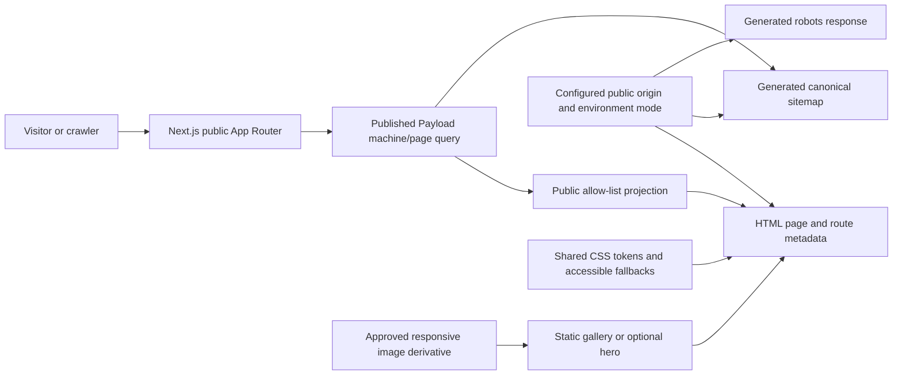

# Phase 6: Accessible Design and Inventory SEO - Research

**Researched:** 2026-10-02
**Domain:** Next.js App Router, accessible responsive CSS, inventory SEO
**Confidence:** HIGH for local application patterns and current official documentation; MEDIUM for resulting live indexing/media behavior because staging, browser, infrastructure and Search Console checks are deferred.

<user_constraints>
## User Constraints (from CONTEXT.md)

### Locked Decisions

- Use HGR's approved palette and Inter type: orange `#F86C00`, hover `#E85F00`, accent `#F89800`, text `#171717`, secondary text `#5F6368`, white/light backgrounds, and dark feature surfaces `#151515`/`#222222`.
- Keep the public site mobile-first, product-led, practical/premium, and focused on Available excavators, useful machine details, and enquiry paths. Preserve Phase 5's decision that phone and WhatsApp remain hidden until numbers are configured.
- Keep the approved HGR logo as the home link, with no Home menu item. Use semantic landmarks, clear visible focus, keyboard operation, readable contrast, useful text alternatives, and touch-sized actions.
- Any hero movement is optional polish. Static content is the baseline; it must respect `prefers-reduced-motion`, remain accessible without animation, and have a simplified/static small-screen fallback. Use real HGR machinery media only when a verified approved asset already exists; do not fabricate imagery or claims.
- SEO is inventory-first and factual. Generate metadata/canonical URLs from the configured public origin, retain unique machine slugs, keep sold machine pages accessible, and only emit structured data from visible verified facts.
- Sitemap includes only public canonical pages and published machine records. Robots controls must keep admin/private/API and non-production staging out of indexing. No indexable filters/facets.
- Do not add keyword-volume, ranking, review, price, availability, or local-business facts that are not verified.
- Use the existing Next.js App Router and CSS approach; prefer native browser capabilities and existing components over adding design or animation dependencies.
- Do not run live PostgreSQL/GCS/media/browser/deployment verification in this phase. Validate locally with focused tests, TypeScript, and build using synthetic settings.

### the agent's Discretion

No separate discretion items are recorded in CONTEXT.md.

### Deferred Ideas (OUT OF SCOPE)

No separate deferred-ideas items are recorded in CONTEXT.md. The phase boundary excludes multilingual pages, ecommerce, analytics/tag integrations, paid tools and production/deployment work.
</user_constraints>

<phase_requirements>
## Phase Requirements

The IDs and requirement descriptions in the following table are quoted verbatim from the Phase 6 requirement source. [VERIFIED: `.planning/REQUIREMENTS.md:114-132`]

| ID | Description | Research Support |
|----|-------------|------------------|
| UX-01 | The public site uses central approved HGR colour tokens and Inter with a practical, mostly light responsive layout and selected dark sections. | Existing token stylesheet and mobile breakpoints; reuse and extend it. |
| UX-02 | Action buttons and text meet applicable accessibility contrast requirements while retaining approved HGR brand colours. | Contrast calculations show dark text on orange/accent works; white text on brand orange does not meet WCAG AA. |
| UX-03 | Public navigation, forms and galleries work with keyboard focus, visible labels, readable status text and practical touch targets. | Existing semantic forms/gallery controls and focus styles; check all control types and small breakpoints. |
| UX-04 | The homepage foregrounds real used excavators and direct contact before secondary service promotion. | Existing homepage already leads with Available inventory; keep unset phone/WhatsApp actions hidden. |
| UX-05 | A real-HGR-excavator hero can show the planned scroll-responsive boom/arm motion with anchored body/tracks where it passes performance and usability checks. | Only implement progressive motion if an approved real asset exists and motion remains supplemental; otherwise preserve the static baseline. |
| UX-06 | Mobile, weak-device and reduced-motion visitors receive a static or simplified hero with immediate access to inventory and contact actions. | Existing CSS reduced-motion handling; no-animation content must remain complete. |
| UX-07 | Approved logo, favicon, sharing assets and real-machine images are used only with appropriate rights; placeholder or fabricated images/claims are absent at launch. | No image assets were found in the repository extension scan; missing asset fallback is explicitly approved. |
| SEO-01 | Public home, inventory, unit and supporting pages have appropriate unique titles/descriptions and accurate canonical URLs. | Next `generateMetadata` plus configured `metadataBase`; source metadata from visible, published content. |
| SEO-02 | Published machine pages have stable, physical-unit-specific URLs; genuine URL changes have redirects where required. | Phase 4 already enforces HGR-unit slug identity and permanent redirect for an old slug resolving to its own machine. |
| SEO-03 | A current XML sitemap lists appropriate public canonical pages and excludes drafts, private/admin and staging content. | Next `sitemap.ts` metadata convention and published-only public query. |
| SEO-04 | Robots and indexing controls prevent staging, draft, private-document and unwanted filter/facet URLs from becoming indexable. | Remove inherited production `noindex` only for intended public pages; environment-gate indexability and use access controls for staging/private content. |
| SEO-05 | Machine structured data appears only when it accurately matches visible, verified content and never invents a hidden price, review or availability. | Omit invented ratings/reviews and hidden/unapproved offer facts; generate only from current page projection if appropriate. |
| SEO-06 | Machine cards/pages, breadcrumbs and internal links let crawlers and visitors reach inventory without infinite-scroll dependence. | Existing anchor links and bounded pagination; maintain these and add a visible breadcrumb path to machine pages. |
| SEO-07 | Sold pages retain truthful metadata and stay accessible unless a documented specific reason requires removal. | Keep published sold machine pages in routes/sitemap and avoid available-sale language or stale offer markup. |
| SEO-08 | Real machine photos are served at suitable responsive sizes with factual alt text and sharing imagery. | Reuse already-approved Payload derivatives only; metadata image is omitted when no approved image is available. |
| SEO-09 | The site is ready for Search Console verification and appropriate GA4/GTM/Google Ads landing measurements without inventing keyword volumes or ranking claims. | Set configured canonical origin and sitemap; account/verification and GA4/GTM/Ads remain Phase 7/deployment work. |
</phase_requirements>

## Summary

Phase 6 should be implemented as a focused update to the existing Next.js App Router pages and one shared CSS file. The repository already has an HGR palette, responsive breakpoints, focus-visible styles, an inventory-first homepage, crawlable server-rendered inventory links, form labels, gallery buttons and a reduced-motion media query. Keep this structure, tighten contrast and responsive behavior, and add the hero only as a progressively enhanced layer over static content. No design or animation package is needed. [VERIFIED: `src/app/(site)/site.css:1-101`, `src/app/(site)/page.tsx:1-17`, `src/components/site/MachineGallery.tsx:1-32`]

The main SEO issue is global: the shared site layout currently marks every public route `noindex`, while the inventory page separately also sets `noindex`; machine pages set `noindex` too, and supporting pages currently export no metadata. The application has no App Router `robots.ts` or `sitemap.ts`. Phase 6 should deliberately establish public indexing rules, route-specific metadata and a canonical URL policy before adding URLs to a sitemap. [VERIFIED: `src/app/(site)/layout.tsx:6-9`, `src/app/(site)/used-excavators/page.tsx:8-9`, `src/app/(site)/machines/[slug]/page.tsx:11-13`, repository App Router file inventory]

**Primary recommendation:** Reuse the installed Next.js App Router and CSS tokens; centralize public-origin metadata, add route-aware titles/descriptions/canonicals, generated robots and sitemap metadata files, and keep every filter, hero effect, structured-data property and image claim subordinate to published verified inventory content.

## Architectural Responsibility Map

| Capability | Primary Tier | Secondary Tier | Rationale |
|------------|-------------|----------------|-----------|
| Palette, responsive layout, focus and reduced-motion behavior | Browser / Client | — | CSS and semantic markup control presentation and interaction. |
| Optional hero animation | Browser / Client | CDN / Static | Motion is a client presentation enhancement over static machine content/media. |
| Per-route titles, canonical URLs and robots metadata | Frontend Server (SSR) | — | Next server route metadata is derived from route params, environment configuration and public content. |
| Machine publication/slug eligibility for pages and sitemap | API / Backend | Frontend Server (SSR) | The existing Payload query is the source for published, non-archived machine content; rendering/sitemap code must use its public contract. |
| Sitemap/robots responses | Frontend Server (SSR) | — | Next App Router metadata route conventions serve generated crawler metadata. |
| Machine photo delivery and sharing images | CDN / Static | API / Backend | Approved responsive derivatives are media outputs; the current public delivery gate and record access remain authoritative. |

## Project Constraints (from AGENTS.md)

- Keep the approved Next.js App Router, Payload CMS, PostgreSQL and external object-storage architecture portable; do not add hosting-specific URLs, paths or service dependencies.
- Keep secrets and environment-specific values in environment variables. Never commit `.env` values or credentials.
- Preserve factual content: do not invent machine/business/location/price/review/availability claims, legal copy, keyword volumes or rankings. Use a no-image/no-claim fallback when facts or approved media are missing.
- The CMS is for normal owner operations; do not expose technical layout controls unnecessarily.
- The site is lead-generation, not ecommerce. Keep analytics/tag integrations for Phase 7, multilingual routes deferred, and phone/WhatsApp hidden until their numbers are configured.
- Preserve unique physical-machine identity and stable machine URLs; published Sold pages stay accessible. Keep public content separate from private serial and ownership documents.
- Keep the public journey mobile-first, keyboard-operable, accessible and usable without animation. Use real HGR photographs only when rights and approval are verified.
- Prefer simple TypeScript and CSS using existing components and native browser capabilities; avoid unnecessary dependencies.
- For this phase use only synthetic local settings. Do not contact PostgreSQL, GCS/media, browser/device, deployment or production systems; do not create paid resources.
- Before meaningful implementation is reported complete, run focused tests, type checks and a production build with synthetic values; review responsive/accessibility states and ensure no secrets were added. Live/infrastructure verification is deferred.

## Standard Stack

### Core

| Library | Version | Purpose | Why Standard |
|---------|---------|---------|--------------|
| Next.js App Router | `16.3.7` | Public server-rendered routes, route metadata, `robots.ts` and `sitemap.ts`. | Already installed and used by public route group. [VERIFIED: `package.json:1-12`, `src/app/(site)/layout.tsx:1-12`] |
| TypeScript | `5.9.3` | Typed `Metadata` and `MetadataRoute` values plus server route/query work. | Already the project language and typecheck command. [VERIFIED: `package.json:13,30-34`] |
| Shared CSS | Existing `src/app/(site)/site.css` | Design tokens, accessible focus, responsive layout, reduced motion. | Existing site-wide styling implementation; continue extending it. [VERIFIED: `src/app/(site)/layout.tsx:1-4`, `src/app/(site)/site.css:1-101`] |
| Payload public query/projection | Existing project helpers | Published machine data for metadata and sitemap URLs. | Existing public queries enforce published/non-archived reads and project an explicit public machine shape. [VERIFIED: `src/lib/machines/publicQueries.ts:31-52,57-101`, `src/lib/machines/publicProjection.ts:25-82`] |

### Supporting

| Library | Version | Purpose | When to Use |
|---------|---------|---------|-------------|
| Native CSS `prefers-reduced-motion` | Browser capability | Disable or simplify decorative movement and transitions. | Use for any hero/gallery motion; current stylesheet already has a reduced-motion rule. [VERIFIED: `src/app/(site)/site.css:101`] |
| Next.js Metadata API | Same installed Next.js version | Page metadata, `metadataBase`, canonical alternates, robots and Open Graph fields. | Use static `metadata` for fixed pages and `generateMetadata` for published machine/supporting data. [CITED: https://nextjs.org/docs/app/api-reference/functions/generate-metadata] |

### Alternatives Considered

| Instead of | Could Use | Tradeoff |
|------------|-----------|----------|
| Next Metadata and file conventions | Hand-built `<head>` tags or custom XML route handlers | Next's supported App Router conventions avoid duplicate metadata plumbing and provide typed output; no project requirement justifies custom infrastructure. [CITED: https://nextjs.org/docs/app/api-reference/file-conventions/metadata/sitemap] |
| Native CSS and existing client components | A new animation/design library | Adds dependencies and does not resolve the missing approved hero asset or deferred browser/performance verification. Do not add one. [VERIFIED: `.planning/phases/06-accessible-design-and-inventory-seo/06-CONTEXT.md:14-19`] |

**Installation:** None. No external package is required or recommended for this phase. The existing CSS and framework stack are sufficient.

## Architecture Patterns

### System Architecture Diagram



### Recommended Project Structure

Continue the established `src/app/(site)` route group for public page metadata and `src/lib/machines` for reusable public machine reads/projection. Add App Router metadata files alongside the public route group only if that route group's file-convention behavior is verified for the installed Next version; otherwise put crawler metadata in the `src/app` root as Next's convention requires. Do not duplicate machine querying or public safety filtering in the sitemap. [VERIFIED: `src/app/(site)/layout.tsx:1-12`, `src/lib/machines/publicQueries.ts:31-101`; CITED: https://nextjs.org/docs/app/api-reference/file-conventions/metadata/sitemap]

### Pattern 1: Shared public metadata base and route metadata

**What:** Set one absolute `metadataBase` from the configured public origin in the public site's shared layout. Use fixed `metadata` for stable pages; use server-side `generateMetadata` for machine records and CMS-backed support pages. Return a self-canonical path for each intended indexable page; filtered query variants should not become separate indexable landing pages. [CITED: https://nextjs.org/docs/app/api-reference/functions/generate-metadata; VERIFIED: `src/app/(site)/machines/[slug]/page.tsx:27-29`]

The existing source reads `const origin = process.env.SERVER_URL;` before building a machine URL. [VERIFIED: `src/app/(site)/machines/[slug]/page.tsx:27-29`] Next documents `metadataBase` as the root layout's base for relative canonical/Open Graph URLs and `generateMetadata` for dynamic route data. [CITED: https://nextjs.org/docs/app/api-reference/functions/generate-metadata]

```ts
export const metadata = {
  metadataBase: new URL(configuredPublicOrigin),
  title: { default: "...", template: "%s | HGR" },
};

export async function generateMetadata({ params }) {
  const { slug } = await params;
  const result = await getPublicMachineForSlug(slug);
  if (!result.machine) return {};
  return {
    title: verifiedMachineTitle(result.machine),
    description: verifiedMachineDescription(result.machine),
    alternates: { canonical: publicMachinePath(result.machine.slug) },
  };
}
```

This is an illustrative shape, not copy-ready typed code. Keep metadata on the existing Server Component page; Next requires metadata exports in Server Components. Do not include a private serial, fabricated sales claim, hidden price or unapproved image. [CITED: https://nextjs.org/docs/app/api-reference/functions/generate-metadata; VERIFIED: `src/lib/machines/publicProjection.ts:25-82`]

### Pattern 2: Sitemap and robots derived from the public route inventory

**What:** Use `sitemap.ts` to return absolute URLs constructed from the configured origin and the same published public machine read used by the site. Include fixed public routes and all published machine canonical pages, including Sold pages; exclude non-public records, internal admin/API paths, and query-filter combinations. Avoid a fabricated `lastModified`; use a timestamp only when sourced from a reliable record. Next's `robots.ts` and `sitemap.ts` file conventions are supported by the current App Router. [CITED: https://nextjs.org/docs/app/api-reference/file-conventions/metadata/sitemap; https://nextjs.org/docs/app/api-reference/file-conventions/metadata/robots; VERIFIED: `src/lib/machines/publicQueries.ts:31-52`]

Keep production indexing an explicit environment-mode decision. The current site-wide `index:false` is safe as a default but prevents public launch indexing until intentionally made environment-aware. Staging should remain protected and non-indexable; `robots.txt` is a crawl instruction, not access control, and Google explains that a disallowed URL can still appear without its contents. For a staging environment, use the existing staging access boundary and noindex/robots controls together; exact host configuration and live Search Console checks are deferred. [VERIFIED: `src/app/(site)/layout.tsx:6-9`; CITED: https://developers.google.com/search/docs/crawling-indexing/robots/intro, https://developers.google.com/search/docs/crawling-indexing/robots-meta-tag]

### Pattern 3: Accessibility-safe accent use and progressive motion

**What:** Keep palette values as CSS custom properties. Use a measured dark foreground on HGR orange/accent buttons and retain a strong `:focus-visible` outline. W3C WCAG 2.2 AA requires a 4.5:1 minimum contrast ratio for normal text (3:1 for large text); the minimum target-size criterion is 24×24 CSS pixels or a qualifying spacing exception. [CITED: https://www.w3.org/WAI/WCAG22/Understanding/contrast-minimum.html, https://www.w3.org/WAI/WCAG22/Understanding/target-size-minimum]

Calculated from the approved context colors, `#171717` on `#F86C00` is 6.09:1 and on `#F89800` is 8.10:1; white on `#F86C00` is 2.94:1 and fails even the 3:1 large-text threshold. Use the existing dark button text and do not change it to white. The stylesheet already uses dark text for primary buttons and a 3px visible focus outline. [VERIFIED: calculation from `.planning/phases/06-accessible-design-and-inventory-seo/06-CONTEXT.md:12`; source CSS `src/app/(site)/site.css:45-48,17`]

**When to use:** For any optional motion, render the still hero and its inventory/contact actions as complete server-rendered content first. Only enhance with movement when a rights-approved real HGR asset is present; do not make client hydration, scroll position, or animation necessary to discover inventory. Keep motion disabled/simplified at reduced-motion and small-screen conditions. The current CSS already handles reduced motion for existing transitions/animations, but it does not implement the new hero. [VERIFIED: `src/app/(site)/site.css:101`; CITED: `.planning/phases/06-accessible-design-and-inventory-seo/06-CONTEXT.md:14-15`]

## Don't Hand-Roll

| Problem | Don't Build | Use Instead | Why |
|---------|-------------|-------------|-----|
| Page titles, canonicals and Open Graph URL resolution | A custom `<head>` component per route | Next.js Metadata API with shared `metadataBase` | Supported API handles metadata serialization and root-to-route merging. [CITED: https://nextjs.org/docs/app/api-reference/functions/generate-metadata] |
| Robots and sitemap serialization | Hand-maintained XML or independent crawler endpoints | Next App Router `robots.ts` and `sitemap.ts` file conventions | Built-in typed metadata routes. [CITED: https://nextjs.org/docs/app/api-reference/file-conventions/metadata/robots, https://nextjs.org/docs/app/api-reference/file-conventions/metadata/sitemap] |
| Published machine URLs/data for crawler output | A new database query or a raw Payload document spread | Existing public query and explicit projection | Keeps draft/archive filtering, unique slug rules and privacy allow-list in one implementation. [VERIFIED: `src/lib/machines/publicQueries.ts:31-101`, `src/lib/machines/publicProjection.ts:25-82`] |
| Animation and responsive effects | New dependency or animation-required page | Existing CSS and static markup with reduced-motion fallback | Lower complexity and the approved no-dependency approach; real hero media is currently not present in the repository. [VERIFIED: `src/app/(site)/site.css:1-101`; repo extension scan 2026-10-02; CONTEXT: safe implementation defaults] |
| SEO facts | Ratings, reviews, location, Offer/price/availability markup not shown to visitors | No structured data until all emitted fields are visible and verified | Google requires structured data to represent visible page content and follow general guidelines. [CITED: https://developers.google.com/search/docs/appearance/structured-data/sd-policies] |

**Key insight:** For this inventory, canonical URLs and crawlable internal links give search systems stable paths to real physical units. Automatically indexing every search/filter query would create URL variants without HGR-authored unique content; the owner explicitly excludes indexable facets. Search markup must describe the individual visible machine facts and current status accurately, rather than trying to imitate ecommerce offers when price is hidden or the machine is Sold. [VERIFIED: `.planning/phases/06-accessible-design-and-inventory-seo/06-CONTEXT.md:16-19`; CITED: https://developers.google.com/search/docs/crawling-indexing/consolidate-duplicate-urls, https://developers.google.com/search/docs/appearance/structured-data/sd-policies]

## Common Pitfalls

### Pitfall 1: Child metadata cannot undo inherited noindex

**What goes wrong:** Adding an indexable page override while the shared layout continues exporting `robots: { index: false }` can leave the public page noindex. The current shared layout sets that false value, and the listing and machine routes also have their own noindex metadata. [VERIFIED: `src/app/(site)/layout.tsx:6-9`, `src/app/(site)/used-excavators/page.tsx:9`, `src/app/(site)/machines/[slug]/page.tsx:13`]

**How to avoid:** Design a single public/staging policy and test final rendered metadata for the homepage, inventory, support pages and machine pages. Keep the admin/Payload boundary separate and keep draft/private reads denied.

### Pitfall 2: Disallowing robots cannot guarantee a URL is absent from search

**What goes wrong:** A crawler may be unable to read the page's noindex directive if robots.txt disallows the URL; a URL may still appear in results without page content. [CITED: https://developers.google.com/search/docs/crawling-indexing/robots/intro, https://developers.google.com/search/docs/crawling-indexing/robots-meta-tag]

**How to avoid:** Keep staging protected at the access layer and apply environment-appropriate index directives. Do not treat robots rules as a privacy control or public document access check. Staging infrastructure checks are deferred by owner instruction.

### Pitfall 3: Theme colors change contrast when used as text/background pairs

**What goes wrong:** White text on the approved main orange background has a computed ratio of 2.94:1; normal text requires 4.5:1 and large text 3:1. [CITED: https://www.w3.org/WAI/WCAG22/Understanding/contrast-minimum.html; verified calculation from locked palette]

**How to avoid:** Use `#171717` text on orange buttons, check hover/focus/status variants separately, and avoid status conveyed by color alone. Preserve a clearly visible focus outline.

### Pitfall 4: Filter URLs multiply crawlable variants

**What goes wrong:** Search, brand and status parameters can generate many URL combinations even though those combinations are not intended as standalone landing pages.

**How to avoid:** Keep filtering usable through the existing GET form and anchor pagination, canonicalize filtered states to the base inventory where appropriate and mark filter variants noindex. Do not add category/facet routes or sitemap query URLs. [VERIFIED: `src/app/(site)/used-excavators/page.tsx:13-29`; CITED: https://developers.google.com/search/docs/crawling-indexing/consolidate-duplicate-urls]

### Pitfall 5: Empty/stale machine data creates misleading metadata

**What goes wrong:** A stale slug, a database failure, a missing field or a Sold machine could produce metadata that describes the wrong physical machine or implies current availability.

**How to avoid:** Derive metadata only after the normal published public query/projection succeeds. A stale slug should canonicalize/redirect to its own machine's current unique slug; an unavailable/missing document gets no fabricated fallback facts. Keep Sold pages accessible with status-accurate descriptions. [VERIFIED: `src/app/(site)/machines/[slug]/page.tsx:16-24`, `src/lib/machines/publicQueries.ts:57-101`, `src/lib/machines/publicProjection.ts:25-82`]

### Pitfall 6: Hero motion makes a visual asset or client effect mandatory

**What goes wrong:** A fabricated machine photo, motion-required text, or client-only rendering blocks information for people with reduced motion, weak devices or no image delivery.

**How to avoid:** Static layout is the baseline and stays fully useful. No image files were found in the repository scan, so use the approved no-image/no-claim fallback until a rights-cleared real HGR asset is supplied. Do not claim that live media is available; Phase 3's public-media gate and Phase 8 device review remain pending. [VERIFIED: `.planning/phases/06-accessible-design-and-inventory-seo/06-CONTEXT.md:22-25`, Phase 4 summary; local file extension scan]

## Code Examples

Verified patterns from official sources:

### Dynamic machine metadata

```ts
export async function generateMetadata({ params }): Promise<Metadata> {
  const { slug } = await params;
  const result = await getPublicMachineForSlug(slug);
  if (!result.machine) return {};
  const machine = result.machine;
  return {
    title: makeTitleFromVisibleFacts(machine),
    description: makeDescriptionFromVisibleFacts(machine),
    alternates: { canonical: publicMachinePath(machine.slug) },
  };
}
```

This follows Next's documented dynamic metadata pattern for route params and data. Keep `Metadata` and metadata exports in the server page component; avoid duplicate calls by extracting a shared read if the page and metadata each resolve the same machine. [CITED: https://nextjs.org/docs/app/api-reference/functions/generate-metadata]

### Sitemap route shape

```ts
export default async function sitemap(): Promise<MetadataRoute.Sitemap> {
  const { machines } = await getPublicMachines();
  return [
    { url: absoluteURL(homePath) },
    { url: absoluteURL(inventoryPath) },
    ...machines.map((machine) => ({
      url: absoluteURL(publicMachinePath(machine.slug)),
    })),
  ];
}
```

Use this only as the conceptual shape: include only routes that are currently intended to be public, keep machine URLs tied to the existing public projection, and source canonical origin from server configuration. The existing path helper returns `return \`/machines/${encodeURIComponent(slug)}\`;`. [CITED: https://nextjs.org/docs/app/api-reference/file-conventions/metadata/sitemap; VERIFIED: `src/lib/machines/publicQueries.ts:31-52`, `src/lib/machines/publicInventory.ts:152-154`]

## State of the Art

| Old Approach | Current Approach | When Changed | Impact |
|--------------|------------------|--------------|--------|
| Manually inserting head tags, robots output and XML sitemap | Next App Router Metadata API and metadata file conventions | Current Next.js App Router docs | Use typed route metadata rather than maintaining custom output. [CITED: Next.js docs linked above] |
| Hide crawler paths with `robots.txt` alone | Use noindex/access controls for indexing/privacy and robots rules to guide crawling | Current Google Search Central guidance | Robots exclusion is not a security or deindexing guarantee. [CITED: https://developers.google.com/search/docs/crawling-indexing/robots/intro] |
| Add structured data based on site-wide marketing assumptions | Keep markup aligned with visible verified page data | Current Google structured data policies | Omit unsupported ratings, hidden values and stale availability. [CITED: https://developers.google.com/search/docs/appearance/structured-data/sd-policies] |

**Deprecated/outdated:** No project dependency migration is needed. Do not add older hand-generated metadata/XML plumbing alongside the current Next App Router Metadata API.

## Assumptions Log

| # | Claim | Section | Risk if Wrong |
|---|-------|---------|---------------|
| A1 | [RESOLVED] Deployment configuration supplies the intended public canonical origin through `SERVER_URL`; syntax validation cannot prove an operator-selected host is HGR's intended public domain. | Architecture / metadata | A valid but mistaken origin could produce incorrect canonicals; the deployment verification milestone must confirm the configured production origin. |
| A2 | [ASSUMED] Product structured data is not necessary to meet the phase goal when no machine offers/reviews are all visible and verified. | Don't Hand-Roll | Search display may omit enhanced product presentation; the plain organic page remains valid and factual. |
| A3 | [RESOLVED] No repository-approved HGR hero or sharing-image asset is available for this phase, so the implementation uses the no-image/no-claim fallback. | Pitfall 6 | Optional imagery stays absent until a rights-cleared asset is supplied and reviewed; this does not block the static layout or SEO work. |

## Open Questions (RESOLVED)

1. **Indexing boundary — resolved:** Enable indexable output only when the runtime is production, `HGR_PUBLIC_INDEXING_ENABLED` is explicitly `true`, and `SERVER_URL` parses as a valid credential-free HTTP(S) origin. Missing or invalid values and every other runtime remain non-indexable; the code does not set deployment values or claim that crawler directives protect staging. Evidence: the current shared layout defaults to `index: false`, machine metadata already uses `SERVER_URL`, and the phase context locks factual configured-origin SEO while deferring deployment checks. [VERIFIED: `src/app/(site)/layout.tsx`, `src/app/(site)/machines/[slug]/page.tsx`, `06-CONTEXT.md` D-05 and D-09]

2. **Approved visual assets — resolved:** The repository scan found no approved real HGR hero or sharing-image asset, and the phase context plus UI contract explicitly require a useful no-image/no-claim state when none is available. Implement the static text-led fallback and omit hero/share imagery; a missing asset does not block implementation. Add imagery only after a rights-cleared HGR file is supplied and approved. [VERIFIED: `06-CONTEXT.md` D-04 and Safe implementation defaults; `06-UI-SPEC.md` hero/image contract; repository asset scan]

## Environment Availability

This phase adds no external dependency and requires only the existing local Node/Next toolchain. Node is present as `v24.21.0`; the project declares `"node": ">=22.23.3 <23 || >=24 <25"`. [VERIFIED: local `node --version`; `package.json:6-8`]

No database, storage service, browser automation, deployment host or paid SEO tool is part of this phase. PostgreSQL, GCS/media, browser/device and deployment verification remain explicitly deferred.

## Validation Architecture

### Test Framework

| Property | Value |
|----------|-------|
| Framework | Node.js built-in test runner used by existing `.mjs` tests. |
| Config file | None required for the existing runner. |
| Quick run command | `node --test <focused Phase 6 test files>` (planner creates focused tests for metadata, robots/sitemap, contrast and fallback behavior). |
| Full suite command | `node --test tests/*.test.mjs` (existing full suite has a previously recorded sandbox `tsx` child-process failure; use focused Phase 6 tests and report that known limitation if repeated). |

Existing test files use `.mjs` and `node:test`; `package.json` provides `typecheck` and `build` scripts but no `test` script. [VERIFIED: `tests/public-inventory.test.mjs:1-2`, `tests/phase5-pages.test.mjs:1-2`, `package.json:11-15`]

### Phase Requirements → Test Map

| Req ID | Behavior | Test Type | Automated Command | Plan/task coverage |
|--------|----------|------------|-------------------|-------------|
| UX-01 | Shared palette/font and mobile layout contract | Unit + deferred visual review | Focused CSS/token checks; responsive browser/device review deferred | 06-02 Task 1 |
| UX-02 | Button, status, focus and body text contrast | Unit calculation + deferred visual review | WCAG 2 contrast-ratio assertions for applied text, controls and focus pairs | 06-02 Task 1 |
| UX-03 | Keyboard gallery/nav/form operation, visible labels/focus, usable targets | Component/unit + deferred browser review | Focused navigation, focus, target and field-error tests | 06-02 Task 1; 06-04 Tasks 1–2 |
| UX-04 | Inventory and contact order on homepage | Component/unit | Focused homepage rendering test | 06-02 Task 2 |
| UX-05 | Real asset hero remains supplemental and bounded | Unit + deferred performance review | Static/no-image fallback test; device motion/performance review deferred | 06-02 Task 2 |
| UX-06 | Reduced-motion and static mobile fallback | CSS/source assertion + deferred responsive review | Focused fallback test | 06-02 Task 2 |
| UX-07 | Missing/unapproved assets are omitted without fabricated claims | Unit | Focused no-asset/factual-alt test | 06-02 Task 2; 06-03 Tasks 1–2 |
| SEO-01 | Titles/descriptions/canonicals are unique and accurate | Unit | Focused metadata helper/page tests | 06-01 Tasks 1–2 |
| SEO-02 | Stable unique slugs and same-machine redirects remain | Existing unit + regression | `node --test tests/public-inventory.test.mjs` plus metadata regression | 06-01 Task 1 |
| SEO-03 | Sitemap contains allowed canonical public URLs | Unit | Focused sitemap projection test | 06-05 Task 2 |
| SEO-04 | Environment noindex, drafts/private/facets excluded | Unit | Focused metadata, robots and sitemap policy tests | 06-01 Task 2; 06-05 Tasks 1–2 |
| SEO-05 | Structured data matches visible public facts | Unit | Test included JSON-LD equals the public projection; omitted fields stay omitted | 06-01 Task 1; 06-03 Task 2 |
| SEO-06 | Internal anchors and bounded pagination are crawlable | Existing unit + rendering | `node --test tests/public-inventory.test.mjs` plus route test | 06-01 Task 2 |
| SEO-07 | Sold page remains accessible and metadata is truthful | Unit | Focused metadata/status regression | 06-01 Task 1 |
| SEO-08 | Only safe responsive derivatives and factual alt/sharing data appear | Unit | Focused asset projection test; live bytes deferred | 06-03 Tasks 1–2 |
| SEO-09 | Configured canonical origin and sitemap output are ready; analytics stays out | Unit | Focused origin/metadata/crawler-output tests | 06-01 Tasks 1–2; 06-05 Tasks 1–2 |

### Sampling Rate

- **Per task commit:** Run the focused Node test command mapped to that plan task and `npm run typecheck`.
- **Per wave merge:** Run the combined Phase 6 tests and `npm run build` with synthetic environment values.
- **Phase gate:** Run the checks recorded in `06-VALIDATION.md` before `$gsd-verify-work`; actual browser/device, media service, Search Console and deployment checks remain deferred as instructed.

### Wave 0 Gaps

No separate test-infrastructure task is required: the existing Node built-in runner and TypeScript/build scripts cover this phase, and each implementation task creates or extends its focused tests before verification. WCAG contrast assertions are assigned to 06-02 Task 1. The task-to-requirement command map and synthetic build gate are recorded in `06-VALIDATION.md`; manual browser/device, media service, Search Console and deployment checks remain deferred.

## Security Domain

Metadata and crawler files must use the same published/public data boundary as the rendered page. A sitemap is an index of intended public routes, never a shortcut around Payload access controls; keep drafts, private serial data and original documents inaccessible at page/API/media layers regardless of robots directives. [VERIFIED: `src/lib/machines/publicQueries.ts:31-52,57-101`, `src/lib/machines/publicProjection.ts:25-82`; CITED: https://developers.google.com/search/docs/crawling-indexing/robots/intro]

### Applicable ASVS Categories

| ASVS Category | Applies | Standard Control |
|---------------|---------|-----------------|
| V2 Authentication | No phase change | Existing Payload authentication is outside public metadata work. |
| V3 Session Management | No phase change | Do not add session behavior for SEO. |
| V4 Access Control | Yes | Preserve existing published/non-archived query and public allow-list; never rely on robots.txt for access control. |
| V5 Input Validation | Yes | Keep search/status/page query normalization bounded and explicit; existing query helper already caps user text and validates statuses. [VERIFIED: `src/lib/machines/publicInventory.ts:24-42`; quote: `const validStatuses = new Set<InventoryStatus>(["available", "reserved", "sold"]);`] |
| V6 Cryptography | No phase change | Do not add cryptographic or credential behavior. |

### Known Threat Patterns for Next.js App Router SEO

| Pattern | STRIDE | Standard Mitigation |
|---------|--------|---------------------|
| Draft/private machine or document URL leaks into sitemap/JSON-LD | Information Disclosure | Generate from the public Payload read/projection only; assert draft/private fields are absent. |
| Canonical host points to staging or attacker-controlled configured URL | Spoofing | Validate public origin configuration and keep staging indexing disabled/protected. |
| Search query values are reflected into generated metadata/schema | Tampering / XSS | Never derive markup from arbitrary query strings; normalize bounded search input and serialize structured data through framework-safe JSON handling. |
| Robots rules mistaken for privacy boundary | Information Disclosure | Keep actual Payload/API/media authorization intact and protect staging separately. |

## Sources

### Primary (HIGH confidence)

- Current repository source read during this session: `src/app/(site)/site.css`, public route pages/layout, `src/lib/machines/publicQueries.ts`, `src/lib/machines/publicProjection.ts`, `src/lib/machines/publicInventory.ts`, tests and `package.json`.
- Phase decision/requirement sources read during this session: `.planning/phases/06-accessible-design-and-inventory-seo/06-CONTEXT.md`, `.planning/REQUIREMENTS.md`, `.planning/phases/04-public-used-excavator-inventory/04-RESEARCH.md`, `.planning/phases/04-public-used-excavator-inventory/04-01-SUMMARY.md`, `.planning/phases/05-enquiries-and-supporting-pages/05-RESEARCH.md`, `.planning/phases/05-enquiries-and-supporting-pages/05-01-VERIFICATION.md`.

### Secondary (MEDIUM confidence)

- [Next.js `generateMetadata`](https://nextjs.org/docs/app/api-reference/functions/generate-metadata) — server metadata, `metadataBase`, canonical alternates and dynamic route metadata.
- [Next.js sitemap convention](https://nextjs.org/docs/app/api-reference/file-conventions/metadata/sitemap) and [robots convention](https://nextjs.org/docs/app/api-reference/file-conventions/metadata/robots) — typed App Router metadata files.
- [W3C WCAG 2.2 contrast](https://www.w3.org/WAI/WCAG22/Understanding/contrast-minimum.html) and [target size](https://www.w3.org/WAI/WCAG22/Understanding/target-size-minimum) — measurable accessibility criteria.
- [Google canonical URLs](https://developers.google.com/search/docs/crawling-indexing/consolidate-duplicate-urls), [robots guidance](https://developers.google.com/search/docs/crawling-indexing/robots/intro), [structured data policies](https://developers.google.com/search/docs/appearance/structured-data/sd-policies) — canonical/sitemap signals, indexing versus crawling, visible-content rule.

## Metadata

**Confidence breakdown:**
- Standard stack: HIGH — read from the current package and route code; no package additions.
- Architecture: HIGH — follows existing public query/projection and official Next metadata conventions.
- Pitfalls: HIGH — global noindex, missing crawler metadata files, current palette and media-gate patterns verified in source; live staging/search behavior remains untested.
- Visual hero performance: LOW until an approved real hero asset and the deferred device/browser checks are available.

**Research date:** 2026-10-02
**Valid until:** 2026-11-01 for the current stable architecture; refresh framework/API details if dependencies change.
